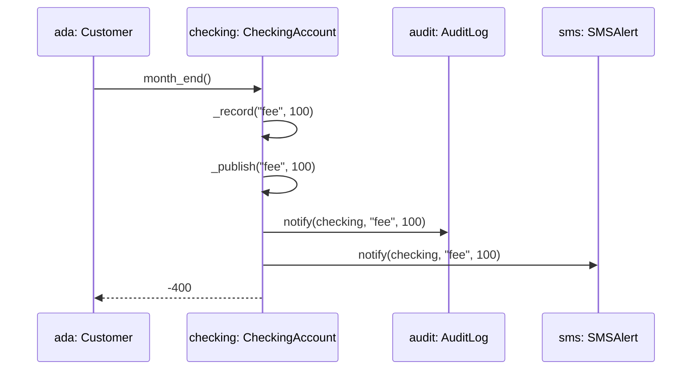
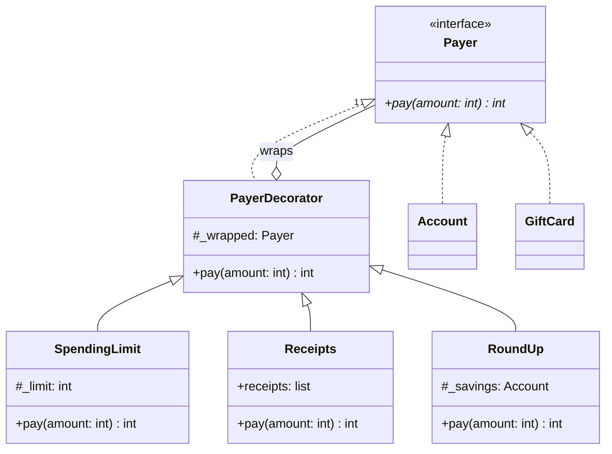

# Introduction to Design Patterns

<span class="badge badge--time">90 min</span>
<span class="badge badge--level">Object-Oriented Design</span>
<span class="badge">Needs: Introduction to UML Modeling</span>

Some design problems come up in almost every program: creating the
right object without knowing its class in advance, telling other parts
of the system that something happened, adding optional features
without a new subclass for every combination. Developers solved them
long ago and gave the solutions names. Those are **design patterns**.
In this last tutorial of the module you apply three of them to the
wallet: **Factory**, **Observer** and **Decorator**.

## Why this matters

A pattern is two things at once. It is a **proven solution**, so you do
not have to invent one under deadline pressure. And it is a **shared
word**: saying "the accounts publish events, the SMS service is an
observer" explains a whole design in one sentence to anyone who knows
the pattern.

You will meet these three everywhere. Web frameworks create objects
through factories and registries. User interfaces, message queues and
webhooks are observers. Python's own `io` module stacks decorators
around files. Recognising the shape saves you hours reading someone
else's code.

## Where we left off

<figure class="h-figure" markdown="0">
<svg viewBox="0 0 680 130" role="img" aria-labelledby="oop5-plan-title oop5-plan-desc">
<title id="oop5-plan-title">How the wallet grows across the module</title>
<desc id="oop5-plan-desc">Version 1, Classes: the Account class: done. Version 2, Inheritance: savings and checking accounts: done. Version 3, Abstract classes: contracts and mixins: done. Version 4, UML: drawing the design: done. Version 5, Patterns: Factory, Observer and Decorator: this page.</desc>
<defs><marker id="oop5-plan-arrow" viewBox="0 0 10 10" refX="9" refY="5" markerWidth="5" markerHeight="5" orient="auto-start-reverse"><path d="M0 0 L10 5 L0 10 z" fill="var(--h-fig-line)"/></marker></defs>
<rect x="3" y="20" width="122" height="90" rx="10" fill="var(--h-fig-box)" stroke="var(--h-fig-text)" stroke-width="1.5"/>
<rect x="141" y="20" width="122" height="90" rx="10" fill="var(--h-fig-box)" stroke="var(--h-fig-text)" stroke-width="1.5"/>
<rect x="279" y="20" width="122" height="90" rx="10" fill="var(--h-fig-box)" stroke="var(--h-fig-text)" stroke-width="1.5"/>
<rect x="417" y="20" width="122" height="90" rx="10" fill="var(--h-fig-box)" stroke="var(--h-fig-text)" stroke-width="1.5"/>
<rect x="555" y="20" width="122" height="90" rx="10" fill="var(--h-cherry)"/>
<g text-anchor="middle">
<text x="64" y="44" font-size="11" font-weight="700" fill="var(--h-fig-muted)">v1 · DONE</text>
<text x="64" y="70" font-size="14" font-weight="700" fill="var(--h-fig-text)">Classes</text>
<text x="64" y="90" font-size="11" fill="var(--h-fig-muted)" font-family="var(--md-code-font-family, monospace)">Account</text>
<text x="202" y="44" font-size="11" font-weight="700" fill="var(--h-fig-muted)">v2 · DONE</text>
<text x="202" y="70" font-size="14" font-weight="700" fill="var(--h-fig-text)">Inheritance</text>
<text x="202" y="90" font-size="11" fill="var(--h-fig-muted)">savings, checking</text>
<text x="340" y="44" font-size="11" font-weight="700" fill="var(--h-fig-muted)">v3 · DONE</text>
<text x="340" y="70" font-size="14" font-weight="700" fill="var(--h-fig-text)">Abstract</text>
<text x="340" y="90" font-size="11" fill="var(--h-fig-muted)">contracts, mixins</text>
<text x="478" y="44" font-size="11" font-weight="700" fill="var(--h-fig-muted)">v4 · DONE</text>
<text x="478" y="70" font-size="14" font-weight="700" fill="var(--h-fig-text)">UML</text>
<text x="478" y="90" font-size="11" fill="var(--h-fig-muted)">draw the design</text>
<text x="616" y="44" font-size="11" font-weight="700" fill="#ffffff" opacity="0.85">v5 · THIS PAGE</text>
<text x="616" y="70" font-size="14" font-weight="700" fill="#ffffff">Patterns</text>
<text x="616" y="90" font-size="11" fill="#ffffff" opacity="0.9">three patterns</text>
</g>
<g stroke="var(--h-fig-line)" stroke-width="2" marker-end="url(#oop5-plan-arrow)">
<line x1="127" y1="65" x2="138" y2="65"/>
<line x1="265" y1="65" x2="276" y2="65"/>
<line x1="403" y1="65" x2="414" y2="65"/>
<line x1="541" y1="65" x2="552" y2="65"/>
</g>
</svg>
</figure>

Start from version 4, or the tag
[`v4-uml`](https://github.com/evisp/oop-wallet/tree/v4-uml): a customer
with accounts and gift cards, a class diagram and two sequence
diagrams. The wallet is now in use, and three requests have arrived:

> 1. New account types keep being added, and accounts are created in
>    many places: when a customer signs up, when data is imported from
>    another system, in tests. Adding a type must not mean editing all
>    of them.
> 2. Other parts of the system need to react to transactions. An audit
>    log must record everything, and customers can ask for a text
>    message when they are charged a fee. Accounts must not need to know
>    who is listening.
> 3. Payments can get optional extras, in any combination: a spending
>    limit, receipts, and rounding each payment up into savings.

Each request is the classic problem of one pattern.

## Step 1: What a design pattern is

A **design pattern** is a named, reusable strategy for a design problem
that keeps coming back. The idea was popularised in 1994 by the book
*Design Patterns*, written by four authors known ever since as the
*Gang of Four*, which catalogued 23 of them.

The important word is **strategy**. A pattern is not code you copy. It
describes roles and how they collaborate, and you write it fresh each
time, shaped to your program. Every pattern description has the same
four parts:

- a **name**, so people can talk about it;
- the **problem** it solves, and the signs that you have that problem;
- the **solution**: the classes involved and what each one does;
- the **consequences**: what you gain, and what it costs.

Patterns are grouped by the kind of problem they solve.

<figure class="h-figure" markdown="0">
<svg viewBox="0 0 680 216" role="img" aria-labelledby="dp-fam-title dp-fam-desc">
<title id="dp-fam-title">The three families of design patterns</title>
<desc id="dp-fam-desc">Creational patterns are about how objects are created: Factory, covered on this page, Builder and Singleton. Structural patterns are about how objects are combined: Decorator, covered on this page, Adapter and Facade. Behavioural patterns are about how objects communicate: Observer, covered on this page, Strategy and Command.</desc>
<g>
<rect x="3" y="8" width="218" height="200" rx="12" fill="var(--h-fig-box)" stroke="var(--h-fig-line)"/>
<rect x="231" y="8" width="218" height="200" rx="12" fill="var(--h-fig-box)" stroke="var(--h-fig-line)"/>
<rect x="459" y="8" width="218" height="200" rx="12" fill="var(--h-fig-box)" stroke="var(--h-fig-line)"/>
</g>
<g font-size="15" font-weight="700" fill="var(--h-fig-text)">
<text x="22" y="40">Creational</text>
<text x="250" y="40">Structural</text>
<text x="478" y="40">Behavioural</text>
</g>
<g font-size="11.5" fill="var(--h-fig-muted)">
<text x="22" y="60">how objects are created</text>
<text x="250" y="60">how objects are combined</text>
<text x="478" y="60">how objects communicate</text>
</g>
<g font-size="12.5" font-weight="700">
<rect x="22" y="78" width="180" height="34" rx="8" fill="var(--h-cherry)"/><text x="38" y="100" fill="#ffffff">Factory · this page</text>
<rect x="22" y="120" width="180" height="34" rx="8" fill="var(--md-default-bg-color)" stroke="var(--h-fig-line)"/><text x="38" y="142" fill="var(--h-fig-text)">Builder</text>
<rect x="22" y="162" width="180" height="34" rx="8" fill="var(--md-default-bg-color)" stroke="var(--h-fig-line)"/><text x="38" y="184" fill="var(--h-fig-text)">Singleton</text>
<rect x="250" y="78" width="180" height="34" rx="8" fill="var(--h-cherry)"/><text x="266" y="100" fill="#ffffff">Decorator · this page</text>
<rect x="250" y="120" width="180" height="34" rx="8" fill="var(--md-default-bg-color)" stroke="var(--h-fig-line)"/><text x="266" y="142" fill="var(--h-fig-text)">Adapter</text>
<rect x="250" y="162" width="180" height="34" rx="8" fill="var(--md-default-bg-color)" stroke="var(--h-fig-line)"/><text x="266" y="184" fill="var(--h-fig-text)">Facade</text>
<rect x="478" y="78" width="180" height="34" rx="8" fill="var(--h-cherry)"/><text x="494" y="100" fill="#ffffff">Observer · this page</text>
<rect x="478" y="120" width="180" height="34" rx="8" fill="var(--md-default-bg-color)" stroke="var(--h-fig-line)"/><text x="494" y="142" fill="var(--h-fig-text)">Strategy</text>
<rect x="478" y="162" width="180" height="34" rx="8" fill="var(--md-default-bg-color)" stroke="var(--h-fig-line)"/><text x="494" y="184" fill="var(--h-fig-text)">Command</text>
</g>
</svg>
</figure>

| Family | The question it answers | Pattern on this page | The problem it solves |
|---|---|---|---|
| **Creational** | How do I create objects without tying my code to their classes? | Factory | Code everywhere that names concrete classes to create them |
| **Structural** | How do I combine objects into bigger ones? | Decorator | Optional features that would need a subclass per combination |
| **Behavioural** | How do objects share work and tell each other things? | Observer | One object that must inform others it should not depend on |

## Step 2: Factory

### The problem: creation scattered everywhere

Without a factory, every place that creates accounts must know every
account class, and how to choose between them:

```python
# in the sign-up code
if kind == "savings":
    account = SavingsAccount(name, rate=rate)
elif kind == "checking":
    account = CheckingAccount(name, overdraft=overdraft)
else:
    raise ValueError(f"unknown account kind: {kind!r}")

# in the import code: the same chain again
# in the tests: the same chain again
```

This is **coupling**: the sign-up code, the import code and the tests
all depend directly on `SavingsAccount` and `CheckingAccount`. Add a
business account and you must find and edit every chain. Miss one and
that part of the program cannot create the new type.

### The solution: one place that knows the classes

A **factory** is an object whose job is to create other objects. The
version here keeps a **registry**: a dictionary from a *kind*, such as
`"savings"`, to the class that creates it.

```python
class AccountFactory:
    """Create accounts by kind, from a registry of account classes."""

    def __init__(self):
        self._registry = {}

    def register(self, kind, account_class):
        """Make kind create account_class, and return account_class."""
        if not isinstance(kind, str) or not kind.strip():
            raise ValueError("kind must be a non-empty string")
        if not (isinstance(account_class, type)
                and issubclass(account_class, Account)):
            raise TypeError("account_class must be a subclass of Account")
        self._registry[kind] = account_class
        return account_class

    def create(self, kind, owner, **options):
        """Create an account of a registered kind."""
        if kind not in self._registry:
            raise ValueError(f"unknown account kind: {kind!r}")
        return self._registry[kind](owner, **options)

    def kinds(self):
        """The registered kinds, sorted."""
        return sorted(self._registry)


account_factory = AccountFactory()
account_factory.register("savings", SavingsAccount)
account_factory.register("checking", CheckingAccount)
```

Two details make this work. Classes are objects in Python, so they can
be stored in a dictionary as values and called later:
`self._registry[kind]` *is* `SavingsAccount`, and adding
`(owner, **options)` calls it. And `**options` passes any keyword
arguments straight through, so the factory does not need to know which
options each class takes.

Every caller now goes through one door. The customer gets a method for
it:

```python
    def open_account(self, kind, **options):
        """Open a new account of a registered kind, and return it."""
        account = account_factory.create(kind, self._name, **options)
        return self.add_account(account)
```

```python
ada = Customer("Ada", "ada@example.com")
ada.open_account("savings", balance=1000, rate=2)
ada.open_account("checking", overdraft=500)
```

<figure class="h-figure" markdown="0">
<svg viewBox="0 0 680 244" role="img" aria-labelledby="dp-fac-title dp-fac-desc">
<title id="dp-fac-title">Before and after a factory</title>
<desc id="dp-fac-desc">Before: sign-up, import and tests each create SavingsAccount and CheckingAccount directly, giving six tangled dependencies. After: the three callers depend only on the factory, whose registry maps savings, checking and the newly added business kind to their classes.</desc>
<defs><marker id="dp-fac-arrow" viewBox="0 0 10 10" refX="9" refY="5" markerWidth="6" markerHeight="6" orient="auto-start-reverse"><path d="M0 0 L10 5 L0 10 z" fill="var(--h-fig-line)"/></marker></defs>
<text x="3" y="14" font-size="11" font-weight="700" fill="var(--h-fig-muted)">BEFORE · EVERY CALLER KNOWS EVERY CLASS</text>
<text x="372" y="14" font-size="11" font-weight="700" fill="var(--h-fig-muted)">AFTER · CALLERS KNOW ONE FACTORY</text>
<g font-size="12.5" font-weight="700">
<rect x="3" y="34" width="110" height="40" rx="8" fill="var(--h-fig-box)" stroke="var(--h-fig-line)"/><text x="58" y="59" text-anchor="middle" fill="var(--h-fig-text)">sign-up</text>
<rect x="3" y="104" width="110" height="40" rx="8" fill="var(--h-fig-box)" stroke="var(--h-fig-line)"/><text x="58" y="129" text-anchor="middle" fill="var(--h-fig-text)">import</text>
<rect x="3" y="174" width="110" height="40" rx="8" fill="var(--h-fig-box)" stroke="var(--h-fig-line)"/><text x="58" y="199" text-anchor="middle" fill="var(--h-fig-text)">tests</text>
<rect x="200" y="64" width="140" height="40" rx="8" fill="var(--md-default-bg-color)" stroke="var(--h-fig-text)" stroke-width="1.5"/><text x="270" y="89" text-anchor="middle" fill="var(--h-fig-text)">SavingsAccount</text>
<rect x="200" y="144" width="140" height="40" rx="8" fill="var(--md-default-bg-color)" stroke="var(--h-fig-text)" stroke-width="1.5"/><text x="270" y="169" text-anchor="middle" fill="var(--h-fig-text)">CheckingAccount</text>
<rect x="372" y="34" width="96" height="40" rx="8" fill="var(--h-fig-box)" stroke="var(--h-fig-line)"/><text x="420" y="59" text-anchor="middle" fill="var(--h-fig-text)">sign-up</text>
<rect x="372" y="104" width="96" height="40" rx="8" fill="var(--h-fig-box)" stroke="var(--h-fig-line)"/><text x="420" y="129" text-anchor="middle" fill="var(--h-fig-text)">import</text>
<rect x="372" y="174" width="96" height="40" rx="8" fill="var(--h-fig-box)" stroke="var(--h-fig-line)"/><text x="420" y="199" text-anchor="middle" fill="var(--h-fig-text)">tests</text>
</g>
<g stroke="var(--h-fig-line)" stroke-width="1.6" fill="none" marker-end="url(#dp-fac-arrow)">
<line x1="117" y1="54" x2="194" y2="80"/><line x1="117" y1="58" x2="194" y2="154"/>
<line x1="117" y1="120" x2="194" y2="90"/><line x1="117" y1="128" x2="194" y2="158"/>
<line x1="117" y1="190" x2="194" y2="98"/><line x1="117" y1="196" x2="194" y2="170"/>
<line x1="472" y1="54" x2="506" y2="108"/><line x1="472" y1="124" x2="506" y2="124"/><line x1="472" y1="194" x2="506" y2="140"/>
</g>
<rect x="512" y="34" width="165" height="180" rx="10" fill="var(--h-cherry)"/>
<text x="594" y="58" text-anchor="middle" font-size="13" font-weight="700" fill="#ffffff">account_factory</text>
<text x="594" y="76" text-anchor="middle" font-size="10.5" fill="#ffffff" opacity="0.9">registry</text>
<g font-size="11" font-family="var(--md-code-font-family, monospace)" fill="#ffffff">
<rect x="524" y="88" width="141" height="30" rx="6" fill="rgba(255,255,255,0.14)"/><text x="534" y="107">"savings"</text>
<rect x="524" y="126" width="141" height="30" rx="6" fill="rgba(255,255,255,0.14)"/><text x="534" y="145">"checking"</text>
<rect x="524" y="164" width="141" height="30" rx="6" fill="none" stroke="#ffffff" stroke-dasharray="4 3"/><text x="534" y="183">"business"  new</text>
</g>
</svg>
</figure>

### Extend the registry without touching the creation logic

Now a business account arrives. It is a checking account with a higher
fee. Write the class, register it, and use it:

```python
class BusinessAccount(CheckingAccount):
    """A checking account for companies, with a higher monthly fee."""

    fee = 250


account_factory.register("business", BusinessAccount)

acme = Customer("Acme", "hello@acme.example")
acme.open_account("business", overdraft=2000)
# BusinessAccount(owner='Acme', balance=0, overdraft=2000)
account_factory.kinds()
# ['business', 'checking', 'savings']
```

`create` did not change, and neither did `open_account`, the import
code or the tests. They all create business accounts already. This is
the **open/closed principle**: a design should be *open* to extension,
by adding a class and a registration, but *closed* to modification of
code that already works.

The factory also makes it natural to create objects from **data**,
where the kind is just a string, for example in a record read from a
JSON file:

```python
record = {"kind": "savings", "owner": "Ada", "balance": 500, "rate": 2}
account_factory.create(**record)
# SavingsAccount(owner='Ada', balance=500, rate=2)
```

And mistakes fail early, with clear messages:

```
account_factory.create("crypto", "Ada")      -> ValueError: unknown account kind: 'crypto'
account_factory.register("gift", GiftCard)   -> TypeError: account_class must be a subclass of Account
```

**Consequences.** The registry gives you one place to see every kind,
and new types plug in without edits. The cost: kinds are strings, so a
typo is only found when the code runs, and `account_factory` is shared
state that every part of the program can change.

!!! tip "Factory Method"

    The Gang of Four describe a related pattern, *Factory Method*, in
    which subclasses decide which class to create by overriding a
    method. The registry version here is the one you will meet most in
    Python code. Both share the same goal: callers ask for *a kind of*
    object, not a specific class.

## Step 3: Observer

### The problem: an object that knows too much

The obvious way to add the audit log and the SMS alerts is to call
them from the account:

```python
    def month_end(self):
        if self._balance < 0:
            self._balance -= self.fee
            audit_log.write(...)     # the account now depends on the audit log
            sms_service.send(...)    # ...and on the SMS service
```

Now `CheckingAccount` depends on two services it has nothing to do
with. Every new listener means editing every account class, and you
cannot test an account without an audit log and an SMS service
present.

### The solution: publish events, let others subscribe

The **Observer** pattern has two roles. A **subject** publishes events.
**Observers** subscribe to the subject, and are notified when events
happen. The subject keeps a list of observers and calls one method on
each, without knowing what they are.

In the wallet, the subject role is a mixin, since both accounts and
gift cards play it. Events have a **topic**, which is the transaction
kind, so observers can ask for only the topics they care about:

```python
class ObservableMixin:
    """Let observers subscribe to this object's events, by topic."""

    def subscribe(self, observer, topics=None):
        """Send observer the events in topics, or every event if None."""
        if not callable(getattr(observer, "notify", None)):
            raise TypeError("observer must have a notify method")
        if isinstance(topics, str):
            topics = [topics]
        wanted = None if topics is None else frozenset(topics)
        if "_observers" not in vars(self):
            self._observers = []
        self._observers.append((observer, wanted))

    def unsubscribe(self, observer):
        """Stop sending events to observer."""
        observers = vars(self).get("_observers", [])
        observers[:] = [(o, t) for o, t in observers if o is not observer]

    def _publish(self, topic, amount):
        """Notify every observer that wants this topic."""
        for observer, wanted in list(vars(self).get("_observers", ())):
            if wanted is None or topic in wanted:
                observer.notify(self, topic, amount)

    def _record(self, kind, amount):
        """Record the transaction, then publish it as an event."""
        super()._record(kind, amount)
        self._publish(kind, amount)
```

The subject relies on **duck typing**: an observer is anything with a
`notify(source, topic, amount)` method. That is how it publishes events
"without knowing the concrete type of every listener". It never
imports, names or checks for `AuditLog` or `SMSAlert`.

The clever part is the last method. Accounts already call
`self._record(...)` for every transaction. `ObservableMixin` overrides
`_record`, lets the real one run through `super()`, then publishes. Put
it first in the list of parents:

```python
class Account(ObservableMixin, HistoryMixin, JSONMixin, Payer):
    ...

Account.mro()
# [Account, ObservableMixin, HistoryMixin, JSONMixin, Payer, ABC, object]
```

`super()` inside `ObservableMixin` follows the MRO to the *next* class,
`HistoryMixin`, not to `ObservableMixin`'s own parent. This is the
method resolution order from Abstract Classes doing real work: every
account and gift card now publishes events, and not a single method
in them changed.

### Observers

An observer is a small class with a `notify` method:

```python
class AuditLog:
    """Observer: keep one line for every event it is sent."""

    def __init__(self):
        self.lines = []

    def notify(self, source, topic, amount):
        """Record the event."""
        self.lines.append(f"{type(source).__name__} {topic} {amount}")
```

To **add a new observer and configure it for specific topics**, write
the class and pass `topics` when subscribing. The SMS alert only cares
about fees:

```python
class SMSAlert:
    """Observer: text a phone number about the events it is sent."""

    def __init__(self, phone):
        self.phone = phone
        self.sent = []

    def notify(self, source, topic, amount):
        """Send a short message about the event."""
        self.sent.append(f"To {self.phone}: {topic} of {amount} ALL")
```

```python
checking = CheckingAccount("Ada", overdraft=500)
audit = AuditLog()
sms = SMSAlert("+355 69 000 0000")
checking.subscribe(audit)                  # every topic
checking.subscribe(sms, topics=["fee"])    # fees only

checking.withdraw(300)
checking.month_end()
checking.deposit(50)

audit.lines   # ['CheckingAccount withdraw 300', 'CheckingAccount fee 100', 'CheckingAccount deposit 50']
sms.sent      # ['To +355 69 000 0000: fee of 100 ALL']
```

<figure class="h-figure" markdown="0">
<svg viewBox="0 0 680 210" role="img" aria-labelledby="dp-obs-title dp-obs-desc">
<title id="dp-obs-title">One event, filtered by topic</title>
<desc id="dp-obs-desc">The checking account publishes a fee event of 100 lek. The audit log subscribed to every topic, so it is notified. The SMS alert subscribed to the fee topic, so it is notified. A second SMS alert that subscribed only to deposit is not notified.</desc>
<defs><marker id="dp-obs-arrow-c" viewBox="0 0 10 10" refX="9" refY="5" markerWidth="6" markerHeight="6" orient="auto-start-reverse"><path d="M0 0 L10 5 L0 10 z" fill="var(--h-cherry)"/></marker></defs>
<rect x="3" y="62" width="200" height="86" rx="10" fill="var(--h-fig-box)" stroke="var(--h-fig-text)" stroke-width="1.5"/>
<text x="20" y="88" font-size="11" font-weight="700" fill="var(--h-fig-muted)">SUBJECT</text>
<text x="20" y="110" font-size="13" font-weight="700" fill="var(--h-fig-text)" font-family="var(--md-code-font-family, monospace)">checking</text>
<text x="20" y="130" font-size="11.5" fill="var(--h-fig-muted)">publishes every transaction</text>
<rect x="240" y="88" width="120" height="34" rx="17" fill="var(--h-cherry)"/>
<text x="300" y="110" text-anchor="middle" font-size="12.5" font-weight="700" fill="#ffffff" font-family="var(--md-code-font-family, monospace)">"fee", 100</text>
<line x1="207" y1="105" x2="236" y2="105" stroke="var(--h-cherry)" stroke-width="2"/>
<g font-size="12.5">
<rect x="430" y="8" width="247" height="56" rx="10" fill="var(--md-default-bg-color)" stroke="var(--h-fig-text)" stroke-width="1.5"/>
<text x="446" y="32" font-weight="700" fill="var(--h-fig-text)">audit: AuditLog</text>
<text x="446" y="52" font-size="11" fill="var(--h-fig-muted)">topics: all · notified</text>
<rect x="430" y="77" width="247" height="56" rx="10" fill="var(--md-default-bg-color)" stroke="var(--h-fig-text)" stroke-width="1.5"/>
<text x="446" y="101" font-weight="700" fill="var(--h-fig-text)">sms: SMSAlert</text>
<text x="446" y="121" font-size="11" fill="var(--h-fig-muted)">topics: fee · notified</text>
<rect x="430" y="146" width="247" height="56" rx="10" fill="none" stroke="var(--h-fig-line)" stroke-dasharray="5 4"/>
<text x="446" y="170" font-weight="700" fill="var(--h-fig-muted)">another SMSAlert</text>
<text x="446" y="190" font-size="11" fill="var(--h-fig-muted)">topics: deposit · skipped</text>
</g>
<g stroke="var(--h-cherry)" stroke-width="2" fill="none" marker-end="url(#dp-obs-arrow-c)">
<path d="M364 100 C 395 100, 395 36, 424 36"/>
<line x1="364" y1="105" x2="424" y2="105"/>
</g>
<path d="M364 110 C 395 110, 395 174, 418 174" fill="none" stroke="var(--h-fig-line)" stroke-width="2" stroke-dasharray="4 4"/>
<text x="406" y="160" font-size="14" font-weight="700" fill="var(--h-fig-muted)">×</text>
</svg>
</figure>

In a sequence diagram, a subject notifying its observers looks like
this:



**Consequences.** Subjects and observers can change independently, and
new listeners need no changes to existing classes. The costs: the flow
of the program is harder to follow, because "who reacts to a fee?" is
answered at run time, not in the code; observers run in the order they
subscribed; an observer that raises an exception stops the ones after
it; and an observer you forget to `unsubscribe` stays alive as long as
the subject does.

## Step 4: Decorator

!!! warning "Not Python's `@decorator`"

    Python has a feature also called a decorator, the `@name` line
    above a function, which you met as `@property` and
    `@abstractmethod`. The **Decorator pattern** is a different, older
    idea: wrapping one *object* in another to add behaviour. They share
    a name because both "wrap" something, but they work differently.

### The problem: subclass explosion

Payments can have a spending limit, receipts and round-up savings, in
any combination, on any kind of payer. With inheritance, each
combination is a subclass:

<figure class="h-figure" markdown="0">
<svg viewBox="0 0 680 262" role="img" aria-labelledby="dp-dec-title dp-dec-desc">
<title id="dp-dec-title">Subclasses for every combination compared with stacked decorators</title>
<desc id="dp-dec-desc">With subclasses, every combination of features and payer type needs its own class, such as LimitedCheckingAccount, ReceiptCheckingAccount and LimitedReceiptRoundUpGiftCard, and the number keeps growing. With decorators, three small wrappers are stacked around any payer: RoundUp around Receipts around SpendingLimit around the checking account. A payment enters at the outer layer and passes inwards.</desc>
<text x="3" y="14" font-size="11" font-weight="700" fill="var(--h-fig-muted)">WITH SUBCLASSES · ONE PER COMBINATION</text>
<text x="300" y="14" font-size="11" font-weight="700" fill="var(--h-fig-muted)">WITH DECORATORS · STACK WHAT YOU NEED</text>
<g font-size="10.5" font-family="var(--md-code-font-family, monospace)" fill="var(--h-fig-text)">
<rect x="3" y="26" width="262" height="26" rx="6" fill="var(--h-fig-box)" stroke="var(--h-fig-line)"/><text x="13" y="43">LimitedCheckingAccount</text>
<rect x="3" y="58" width="262" height="26" rx="6" fill="var(--h-fig-box)" stroke="var(--h-fig-line)"/><text x="13" y="75">ReceiptCheckingAccount</text>
<rect x="3" y="90" width="262" height="26" rx="6" fill="var(--h-fig-box)" stroke="var(--h-fig-line)"/><text x="13" y="107">LimitedReceiptCheckingAccount</text>
<rect x="3" y="122" width="262" height="26" rx="6" fill="var(--h-fig-box)" stroke="var(--h-fig-line)"/><text x="13" y="139">RoundUpSavingsAccount</text>
<rect x="3" y="154" width="262" height="26" rx="6" fill="var(--h-fig-box)" stroke="var(--h-fig-line)"/><text x="13" y="171">LimitedRoundUpGiftCard</text>
<rect x="3" y="186" width="262" height="26" rx="6" fill="var(--h-fig-box)" stroke="var(--h-fig-line)"/><text x="13" y="203">LimitedReceiptRoundUpGiftCard</text>
</g>
<text x="3" y="234" font-size="11.5" font-weight="700" fill="var(--h-cherry)">3 features × 3 payer types: up to 21 classes</text>
<text x="3" y="252" font-size="11" fill="var(--h-fig-muted)">and every new feature doubles the count</text>
<text x="488" y="38" text-anchor="middle" font-size="12" font-weight="700" fill="var(--h-cherry)" font-family="var(--md-code-font-family, monospace)">checkout(payer, 230)</text>
<line x1="488" y1="44" x2="488" y2="60" stroke="var(--h-cherry)" stroke-width="2"/>
<polygon points="482,56 488,64 494,56" fill="var(--h-cherry)"/>
<rect x="300" y="66" width="377" height="190" rx="14" fill="var(--h-fig-box)" stroke="var(--h-fig-text)" stroke-width="1.5"/>
<text x="316" y="86" font-size="12" font-weight="700" fill="var(--h-fig-text)">RoundUp <tspan font-weight="400" fill="var(--h-fig-muted)">saves the 70 lek spare</tspan></text>
<rect x="320" y="96" width="337" height="148" rx="12" fill="var(--md-default-bg-color)" stroke="var(--h-fig-text)" stroke-width="1.5"/>
<text x="336" y="116" font-size="12" font-weight="700" fill="var(--h-fig-text)">Receipts <tspan font-weight="400" fill="var(--h-fig-muted)">writes a receipt</tspan></text>
<rect x="340" y="126" width="297" height="106" rx="10" fill="var(--h-fig-box)" stroke="var(--h-fig-text)" stroke-width="1.5"/>
<text x="356" y="146" font-size="12" font-weight="700" fill="var(--h-fig-text)">SpendingLimit <tspan font-weight="400" fill="var(--h-fig-muted)">refuses over 500</tspan></text>
<rect x="360" y="156" width="257" height="64" rx="8" fill="var(--h-cherry)"/>
<text x="488" y="184" text-anchor="middle" font-size="13" font-weight="700" fill="#ffffff" font-family="var(--md-code-font-family, monospace)">checking</text>
<text x="488" y="204" text-anchor="middle" font-size="11" fill="#ffffff" opacity="0.9">the real payer</text>
</svg>
</figure>

Three features on three kinds of payer is already up to 21 classes, and
each new feature roughly doubles it. Worse, you cannot add a feature to
an object that already exists: its class is fixed when it is created.

### The solution: wrap the object

A **decorator** is an object that has the same interface as the object
it wraps. It adds its own behaviour, then passes the call on. Because
the decorator *is a* `Payer` too, decorators can wrap each other, in any
order and any number. This is **composition**, the "has a" from
Inheritance & Polymorphism: each decorator *has* a payer inside it.



Read the two lines between `PayerDecorator` and `Payer` together: a
decorator *implements* `Payer` and *wraps* a `Payer`. That pair of
lines is the signature of the pattern in any class diagram.

Start with a base class that only passes things on:

```python
class PayerDecorator(Payer):
    """Wrap a payer to add behaviour to pay; forward everything else."""

    def __init__(self, wrapped):
        if not callable(getattr(wrapped, "pay", None)):
            raise TypeError("wrapped must have a pay method")
        self._wrapped = wrapped

    def pay(self, amount):
        """Pass the payment on to the wrapped payer."""
        return self._wrapped.pay(amount)

    def __getattr__(self, name):
        return getattr(self._wrapped, name)

    def __str__(self):
        return str(self._wrapped)

    def __repr__(self):
        return f"{type(self).__name__}({self._wrapped!r})"
```

`__getattr__` is a special method Python calls only when normal lookup
**fails**. Here it forwards anything the decorator does not have to
the wrapped object, so `payer.balance` and `payer.owner` still work.
Special methods such as `__str__` are the exception: Python looks them
up on the class directly, never through `__getattr__`, which is why
`__str__` is forwarded by hand. Without it, `print(payer)` would show
`<PayerDecorator object at 0x...>`.

Each feature is now one small decorator that overrides `pay`:

```python
class SpendingLimit(PayerDecorator):
    """Refuse any single payment above a limit."""

    def __init__(self, wrapped, limit):
        super().__init__(wrapped)
        _check_amount(limit)
        self._limit = limit

    def pay(self, amount):
        """Pay amount, unless it is over the limit."""
        if amount > self._limit:
            raise ValueError(f"payment over the limit of {self._limit}")
        return super().pay(amount)


class Receipts(PayerDecorator):
    """Keep a receipt for every payment that goes through."""

    def __init__(self, wrapped):
        super().__init__(wrapped)
        self.receipts = []

    def pay(self, amount):
        """Pay amount, then write a receipt."""
        result = super().pay(amount)
        self.receipts.append(f"Paid {amount} ALL")
        return result
```

`super().pay(amount)` hands the payment to `PayerDecorator.pay`, which
passes it to the wrapped object. A limit check happens *before* passing
it on; a receipt is written *after*, so only payments that succeed get
one.

### Add a new decorator that composes with the others

Round-up savings is the third feature: every payment is rounded up to
the next 100 lek, and the difference goes into a savings account. Write
it as a new decorator, without changing any existing class:

```python
class RoundUp(PayerDecorator):
    """Round each payment up to the next 100 and save the difference."""

    def __init__(self, wrapped, savings):
        super().__init__(wrapped)
        if not isinstance(savings, Account):
            raise TypeError("savings must be an Account")
        self._savings = savings

    def pay(self, amount):
        """Pay amount, then move the round-up into savings if possible."""
        result = super().pay(amount)
        spare = -amount % 100
        if spare:
            try:
                result = super().pay(spare)
            except ValueError:
                return result
            self._savings.deposit(spare)
        return result
```

`-amount % 100` is the distance to the next multiple of 100: for 230
it is 70. The round-up is a bonus, so if the payer cannot afford the
extra 70, the original payment still stands and nothing is saved.

Now stack all three:

```python
savings = SavingsAccount("Ada", 1000, rate=2)
checking = CheckingAccount("Ada", overdraft=500)

payer = RoundUp(Receipts(SpendingLimit(checking, limit=500)), savings)
checkout(payer, 230)

checking.balance   # -300: 230 paid, plus 70 rounded up
savings.balance    # 1070
payer.receipts     # ['Paid 230 ALL', 'Paid 70 ALL']
repr(payer)        # "RoundUp(Receipts(SpendingLimit(CheckingAccount(owner='Ada', balance=-300, overdraft=500))))"
```

`checkout` did not change: it still just calls `pay`. `payer.receipts`
works even though `RoundUp` has no `receipts`, because `__getattr__`
passes the lookup inward to `Receipts`. And the same decorators wrap a
gift card just as well: `RoundUp(card, savings)` works, because a card
is a `Payer` too.

**Order matters.** The outermost decorator runs first. Move `RoundUp`
inside the others and the result changes:

```python
payer = Receipts(SpendingLimit(RoundUp(checking, savings), limit=500))
checkout(payer, 230)
payer.receipts     # ['Paid 230 ALL']
```

The same 300 lek leaves the account, but now the receipts only see the
outer call, the 230. Neither order is wrong. They mean different
things, and choosing the order is part of the design: here, should the
limit and the receipts include the round-up or not?

**Consequences.** Features combine freely, at run time, and each one is
a small class that is easy to test. The costs: a decorated payer is not
the same object as the one inside it, so `isinstance(payer, Account)` is
`False` and you cannot add it to a customer's accounts; and a deep
stack of wrappers can be harder to debug than one class. That is why
`__repr__` shows the whole stack.

## Step 5: Use patterns, don't collect them

Patterns are tools for problems you already have. Adding one "just in
case" makes code bigger and harder to follow, for no benefit.

| You notice | Consider |
|---|---|
| The same `if kind == ...` creation chain in several places | Factory |
| An object that calls services it should not know about, to tell them something happened | Observer |
| Subclasses whose names list features: `LimitedReceiptRoundUp...` | Decorator |
| One object that must work with an interface it does not match | Adapter |
| A family of interchangeable algorithms chosen at run time | Strategy |

If you cannot point to the problem in the left column, you do not need
the pattern yet.

## The code so far

This is version 5 of the wallet, tagged
[`v5-patterns`](https://github.com/evisp/oop-wallet/tree/v5-patterns).
The changes from version 4 are `ObservableMixin`, `AccountFactory` with
`Customer.open_account`, the decorators, the two observers, and the
demo.

??? example "wallet.py · version 5"

    ```python title="wallet.py"
    #!/usr/bin/env python3
    """A small digital wallet, built up across the OOP tutorials.

    Version 5: Introduction to Design Patterns.
    """
    import json
    from abc import ABC, abstractmethod


    def _check_amount(amount):
        """Raise if amount is not a positive whole number."""
        if isinstance(amount, bool) or not isinstance(amount, int):
            raise TypeError("amount must be an integer")
        if amount <= 0:
            raise ValueError("amount must be positive")


    class TransactionLog(list):
        """A list that only accepts (kind, amount) transaction entries."""

        KINDS = ("deposit", "withdraw", "payment", "interest", "fee")

        def __init__(self, entries=()):
            super().__init__()
            self.extend(entries)

        def append(self, entry):
            """Add one entry, after checking it."""
            self._check(entry)
            super().append(entry)

        def extend(self, entries):
            """Add several entries; check them all before adding any."""
            entries = list(entries)
            for entry in entries:
                self._check(entry)
            super().extend(entries)

        def total(self, kind):
            """Return the sum of all amounts of one kind."""
            return sum(amount for k, amount in self if k == kind)

        def _check(self, entry):
            if not isinstance(entry, tuple) or len(entry) != 2:
                raise TypeError("entry must be a (kind, amount) tuple")
            kind, amount = entry
            if kind not in self.KINDS:
                raise ValueError(f"unknown kind: {kind!r}")
            _check_amount(amount)


    class HistoryMixin:
        """Give a class a transaction history."""

        def _record(self, kind, amount):
            """Add one entry to this object's history."""
            if "_history" not in vars(self):
                self._history = TransactionLog()
            self._history.append((kind, amount))

        @property
        def history(self):
            """A copy of the transaction history."""
            return TransactionLog(vars(self).get("_history", ()))


    class JSONMixin:
        """Give a class a dictionary and JSON form of its simple attributes."""

        def to_dict(self):
            """Return the type and simple attributes as a dictionary."""
            data = {"type": type(self).__name__}
            for name, value in vars(self).items():
                if isinstance(value, (str, int, float, bool)):
                    data[name.lstrip("_")] = value
            return data

        def to_json(self):
            """Return to_dict() as a JSON string."""
            return json.dumps(self.to_dict())


    class ObservableMixin:
        """Let observers subscribe to this object's events, by topic.

        Every recorded transaction is published as an event whose topic is
        its kind: "deposit", "withdraw", "payment", "interest" or "fee".
        """

        def subscribe(self, observer, topics=None):
            """Send observer the events in topics, or every event if None."""
            if not callable(getattr(observer, "notify", None)):
                raise TypeError("observer must have a notify method")
            if isinstance(topics, str):
                topics = [topics]
            wanted = None if topics is None else frozenset(topics)
            if "_observers" not in vars(self):
                self._observers = []
            self._observers.append((observer, wanted))

        def unsubscribe(self, observer):
            """Stop sending events to observer."""
            observers = vars(self).get("_observers", [])
            observers[:] = [(o, t) for o, t in observers if o is not observer]

        def _publish(self, topic, amount):
            """Notify every observer that wants this topic."""
            for observer, wanted in list(vars(self).get("_observers", ())):
                if wanted is None or topic in wanted:
                    observer.notify(self, topic, amount)

        def _record(self, kind, amount):
            """Record the transaction, then publish it as an event."""
            super()._record(kind, amount)
            self._publish(kind, amount)


    class Payer(ABC):
        """Interface: anything that can pay an amount."""

        @abstractmethod
        def pay(self, amount):
            """Pay amount, or raise ValueError; return what is left."""


    class Account(ObservableMixin, HistoryMixin, JSONMixin, Payer):
        """Abstract base for wallet accounts holding money, in whole lek."""

        currency = "ALL"

        def __init__(self, owner, balance=0):
            """Create an account for owner with an opening balance."""
            self.owner = owner
            if isinstance(balance, bool) or not isinstance(balance, int):
                raise TypeError("balance must be an integer")
            if balance < 0:
                raise ValueError("balance must not be negative")
            self._balance = balance
            if balance:
                self._record("deposit", balance)

        @property
        def owner(self):
            """The account holder's name."""
            return self._owner

        @owner.setter
        def owner(self, value):
            if not isinstance(value, str):
                raise TypeError("owner must be a string")
            if not value.strip():
                raise ValueError("owner must not be empty")
            self._owner = value.strip()

        @property
        def balance(self):
            """The current balance. Read-only: use deposit and withdraw."""
            return self._balance

        def deposit(self, amount):
            """Add amount to the balance and return the new balance."""
            _check_amount(amount)
            self._balance += amount
            self._record("deposit", amount)
            return self._balance

        def withdraw(self, amount):
            """Take amount from the balance and return the new balance."""
            _check_amount(amount)
            if amount > self._balance:
                raise ValueError("insufficient funds")
            self._balance -= amount
            self._record("withdraw", amount)
            return self._balance

        def pay(self, amount):
            """Pay amount from this account; return the new balance."""
            return self.withdraw(amount)

        @abstractmethod
        def month_end(self):
            """Apply end-of-month rules and return the new balance."""

        def __str__(self):
            return f"{self.owner}: {self.balance} {self.currency}"

        def __repr__(self):
            return (f"{type(self).__name__}(owner={self.owner!r}, "
                    f"balance={self.balance})")


    class SavingsAccount(Account):
        """An account that earns interest every month."""

        def __init__(self, owner, balance=0, rate=1):
            """Create a savings account; rate is monthly interest in percent."""
            super().__init__(owner, balance)
            if isinstance(rate, bool) or not isinstance(rate, int):
                raise TypeError("rate must be an integer")
            if not 0 <= rate <= 10:
                raise ValueError("rate must be between 0 and 10")
            self._rate = rate

        @property
        def rate(self):
            """Monthly interest rate, in whole percent."""
            return self._rate

        def add_interest(self):
            """Add this month's interest and return the amount added."""
            interest = self._balance * self._rate // 100
            if interest > 0:
                self._balance += interest
                self._record("interest", interest)
            return interest

        def month_end(self):
            """Add this month's interest and return the new balance."""
            self.add_interest()
            return self._balance

        def __repr__(self):
            return (f"{type(self).__name__}(owner={self.owner!r}, "
                    f"balance={self.balance}, rate={self.rate})")


    class CheckingAccount(Account):
        """An everyday account that may go below zero, up to a limit."""

        fee = 100

        def __init__(self, owner, balance=0, overdraft=0):
            """Create a checking account with an overdraft limit."""
            super().__init__(owner, balance)
            if isinstance(overdraft, bool) or not isinstance(overdraft, int):
                raise TypeError("overdraft must be an integer")
            if overdraft < 0:
                raise ValueError("overdraft must not be negative")
            self._overdraft = overdraft

        @property
        def overdraft(self):
            """How far below zero the balance may go."""
            return self._overdraft

        def withdraw(self, amount):
            """Take amount out, letting the balance go down to -overdraft."""
            _check_amount(amount)
            if self._balance - amount < -self._overdraft:
                raise ValueError("overdraft limit exceeded")
            self._balance -= amount
            self._record("withdraw", amount)
            return self._balance

        def month_end(self):
            """Charge the monthly fee if overdrawn; return the new balance."""
            if self._balance < 0:
                self._balance -= self.fee
                self._record("fee", self.fee)
            return self._balance

        def __str__(self):
            return f"{super().__str__()} (overdraft {self.overdraft})"

        def __repr__(self):
            return (f"{type(self).__name__}(owner={self.owner!r}, "
                    f"balance={self.balance}, overdraft={self.overdraft})")


    class GiftCard(ObservableMixin, HistoryMixin, JSONMixin, Payer):
        """A prepaid card with a fixed value. It is not an account."""

        currency = "ALL"

        def __init__(self, code, value):
            """Create a gift card with a code and a starting value."""
            if not isinstance(code, str) or not code.strip():
                raise ValueError("code must be a non-empty string")
            _check_amount(value)
            self._code = code.strip()
            self._value = value
            self._holder = None

        @property
        def holder(self):
            """The customer holding this card, or None."""
            return self._holder

        @property
        def value(self):
            """What is left on the card."""
            return self._value

        def pay(self, amount):
            """Pay amount from the card; return the value left."""
            _check_amount(amount)
            if amount > self._value:
                raise ValueError("not enough value on the card")
            self._value -= amount
            self._record("payment", amount)
            return self._value

        def __str__(self):
            return f"Gift card {self._code}: {self.value} {self.currency}"

        def __repr__(self):
            return f"GiftCard(code={self._code!r}, value={self.value})"


    class AccountFactory:
        """Create accounts by kind, from a registry of account classes."""

        def __init__(self):
            self._registry = {}

        def register(self, kind, account_class):
            """Make kind create account_class, and return account_class."""
            if not isinstance(kind, str) or not kind.strip():
                raise ValueError("kind must be a non-empty string")
            if not (isinstance(account_class, type)
                    and issubclass(account_class, Account)):
                raise TypeError("account_class must be a subclass of Account")
            self._registry[kind] = account_class
            return account_class

        def create(self, kind, owner, **options):
            """Create an account of a registered kind."""
            if kind not in self._registry:
                raise ValueError(f"unknown account kind: {kind!r}")
            return self._registry[kind](owner, **options)

        def kinds(self):
            """The registered kinds, sorted."""
            return sorted(self._registry)


    account_factory = AccountFactory()
    account_factory.register("savings", SavingsAccount)
    account_factory.register("checking", CheckingAccount)


    class Customer(JSONMixin):
        """A wallet customer, who can hold accounts and gift cards."""

        def __init__(self, name, email):
            """Create a customer with a name and an email address."""
            if not isinstance(name, str) or not name.strip():
                raise ValueError("name must be a non-empty string")
            if not isinstance(email, str) or "@" not in email:
                raise ValueError("email must contain @")
            self._name = name.strip()
            self._email = email.strip()
            self._accounts = []
            self._gift_cards = []

        @property
        def name(self):
            """The customer's name."""
            return self._name

        @property
        def email(self):
            """The customer's email address."""
            return self._email

        @property
        def accounts(self):
            """The customer's accounts, as a tuple."""
            return tuple(self._accounts)

        @property
        def gift_cards(self):
            """The customer's gift cards, as a tuple."""
            return tuple(self._gift_cards)

        def add_account(self, account):
            """Add an account this customer owns, and return it."""
            if not isinstance(account, Account):
                raise TypeError("account must be an Account")
            if account.owner != self._name:
                raise ValueError("account belongs to another customer")
            if account in self._accounts:
                raise ValueError("account already added")
            self._accounts.append(account)
            return account

        def open_account(self, kind, **options):
            """Open a new account of a registered kind, and return it."""
            account = account_factory.create(kind, self._name, **options)
            return self.add_account(account)

        def add_gift_card(self, card):
            """Give this customer a gift card nobody else holds; return it."""
            if not isinstance(card, GiftCard):
                raise TypeError("card must be a GiftCard")
            if card.holder is not None:
                raise ValueError("gift card already has a holder")
            card._holder = self
            self._gift_cards.append(card)
            return card

        def total_balance(self):
            """Return the sum of all account balances."""
            return sum(account.balance for account in self._accounts)

        def month_end(self):
            """Run the end-of-month rules on every account."""
            for account in self._accounts:
                account.month_end()

        def __str__(self):
            return (f"{self.name} <{self.email}>: "
                    f"accounts: {len(self._accounts)}, "
                    f"gift cards: {len(self._gift_cards)}")

        def __repr__(self):
            return f"Customer(name={self.name!r}, email={self.email!r})"


    class PayerDecorator(Payer):
        """Wrap a payer to add behaviour to pay; forward everything else."""

        def __init__(self, wrapped):
            if not callable(getattr(wrapped, "pay", None)):
                raise TypeError("wrapped must have a pay method")
            self._wrapped = wrapped

        def pay(self, amount):
            """Pass the payment on to the wrapped payer."""
            return self._wrapped.pay(amount)

        def __getattr__(self, name):
            return getattr(self._wrapped, name)

        def __str__(self):
            return str(self._wrapped)

        def __repr__(self):
            return f"{type(self).__name__}({self._wrapped!r})"


    class SpendingLimit(PayerDecorator):
        """Refuse any single payment above a limit."""

        def __init__(self, wrapped, limit):
            super().__init__(wrapped)
            _check_amount(limit)
            self._limit = limit

        def pay(self, amount):
            """Pay amount, unless it is over the limit."""
            if amount > self._limit:
                raise ValueError(f"payment over the limit of {self._limit}")
            return super().pay(amount)


    class Receipts(PayerDecorator):
        """Keep a receipt for every payment that goes through."""

        def __init__(self, wrapped):
            super().__init__(wrapped)
            self.receipts = []

        def pay(self, amount):
            """Pay amount, then write a receipt."""
            result = super().pay(amount)
            self.receipts.append(f"Paid {amount} ALL")
            return result


    class RoundUp(PayerDecorator):
        """Round each payment up to the next 100 and save the difference."""

        def __init__(self, wrapped, savings):
            super().__init__(wrapped)
            if not isinstance(savings, Account):
                raise TypeError("savings must be an Account")
            self._savings = savings

        def pay(self, amount):
            """Pay amount, then move the round-up into savings if possible."""
            result = super().pay(amount)
            spare = -amount % 100
            if spare:
                try:
                    result = super().pay(spare)
                except ValueError:
                    return result
                self._savings.deposit(spare)
            return result


    class AuditLog:
        """Observer: keep one line for every event it is sent."""

        def __init__(self):
            self.lines = []

        def notify(self, source, topic, amount):
            """Record the event."""
            self.lines.append(f"{type(source).__name__} {topic} {amount}")


    class SMSAlert:
        """Observer: text a phone number about the events it is sent."""

        def __init__(self, phone):
            self.phone = phone
            self.sent = []

        def notify(self, source, topic, amount):
            """Send a short message about the event."""
            self.sent.append(f"To {self.phone}: {topic} of {amount} ALL")


    def checkout(payer, amount):
        """Charge amount to anything that can pay; return what it returns."""
        return payer.pay(amount)


    if __name__ == "__main__":
        ada = Customer("Ada", "ada@example.com")
        savings = ada.open_account("savings", balance=1000, rate=2)
        checking = ada.open_account("checking", overdraft=500)

        audit = AuditLog()
        sms = SMSAlert("+355 69 000 0000")
        for account in ada.accounts:
            account.subscribe(audit)
        checking.subscribe(sms, topics=["fee"])

        payer = RoundUp(Receipts(SpendingLimit(checking, limit=500)), savings)
        checkout(payer, 230)
        ada.month_end()

        for account in ada.accounts:
            print(account)
        print(*payer.receipts, sep="\n")
        print(*audit.lines, sep="\n")
        print(*sms.sent, sep="\n")
    ```

```bash
./wallet.py
```

```
Ada: 1091 ALL
Ada: -400 ALL (overdraft 500)
Paid 230 ALL
Paid 70 ALL
CheckingAccount withdraw 230
CheckingAccount withdraw 70
SavingsAccount deposit 70
SavingsAccount interest 21
CheckingAccount fee 100
To +355 69 000 0000: fee of 100 ALL
```

Read the last lines as a story: the payment of 230 and its 70 lek
round-up leave the checking account, the 70 arrives in savings, the
month ends with 21 lek of interest on the new balance and a 100 lek fee
on the overdrawn account, and only the fee reaches Ada's phone.

## What you built in this module

| Version | Tutorial | What it added |
|---|---|---|
| v1 | Classes & Object Model | `Account`: validation, properties, string representations |
| v2 | Inheritance & Polymorphism | `SavingsAccount`, `CheckingAccount`, one `month_end` call for all |
| v3 | Abstract Classes & Interfaces | the `Payer` interface, abstract `Account`, `GiftCard`, `TransactionLog`, mixins |
| v4 | Introduction to UML Modeling | `Customer`, multiplicities in code, class and sequence diagrams |
| v5 | Introduction to Design Patterns | Factory, Observer and Decorator |

The same few principles carried the whole way: an object protects its
own state, shared promises become interfaces, "is a" becomes
inheritance and "has a" becomes composition, and new behaviour arrives
as new classes rather than edits to old ones.

!!! ai "AI in the loop"

    Patterns are where assistants over-engineer most. Ask one to "add a
    feature using best practices" and it may return three patterns you
    do not need. Ask instead: *"Here is my code and the change I need.
    Which problem do I actually have, and is there a pattern that fits
    it? What would it cost?"* Then compare its answer with the table in
    Step 5, and decide yourself.

## When something goes wrong

??? note "`ValueError: unknown account kind: '...'`"

    The kind was never registered, or is spelled differently. Check
    `account_factory.kinds()`, and make sure `register` runs before the
    first `create`, for example in the same module as the class.

??? note "My observer is never notified"

    Check the topic names it subscribed to: they must match the
    transaction kinds exactly. Passing a single topic as a string works,
    `topics="fee"`, but a typo such as `"fees"` silently matches nothing.

??? note "`AttributeError` on a decorated payer"

    The attribute does not exist on the wrapped object either.
    `__getattr__` forwards lookups inward, so the innermost object must
    have it. Also check that the decorator's own attributes are set
    *before* anything reads them in `__init__`.

??? note "`print(payer)` shows `<... object at 0x...>`"

    The decorator does not define `__str__`. Special methods are not
    forwarded by `__getattr__`, so each one must be passed on by hand.

??? note "A decorated payer is refused by `add_account`"

    A decorator *is a* `Payer`, not an `Account`. Keep the plain account
    in the customer's list, and wrap it only where you pay with it.

## Explain it to someone

- [ ] What a design pattern is, and why it is a strategy rather than a template
- [ ] The difference between creational, structural and behavioural patterns, with an example of each
- [ ] The coupling caused by creating objects directly in many places
- [ ] How a factory registry lets you add a new type without changing the creation code
- [ ] How a subject publishes events without knowing the concrete type of its observers
- [ ] How to add a new observer that receives only some topics
- [ ] Why decorators avoid a subclass for every combination of features
- [ ] How to add a new decorator that works with the existing ones, and why their order matters
- [ ] The difference between the Decorator pattern and Python's `@decorator` syntax
- [ ] When *not* to add a pattern

## Quick reference

| Pattern | Family | Roles in the wallet | Key move |
|---|---|---|---|
| Factory | Creational | `AccountFactory`, its registry, `account_factory` | `register(kind, cls)` once; `create(kind, ...)` everywhere |
| Observer | Behavioural | subject: `ObservableMixin`; observers: `AuditLog`, `SMSAlert` | `subscribe(observer, topics)`; `_publish` calls `notify` |
| Decorator | Structural | `PayerDecorator`, `SpendingLimit`, `Receipts`, `RoundUp` | implement the interface, wrap one, call `super().pay()` |

## Next

You have finished Object-Oriented Design, and with it the Foundations
stage. The next stage builds real applications: data stored in
databases, served through APIs, and shown in the browser.

[Software Development](../../03-software-development/index.md){ .h-button }
