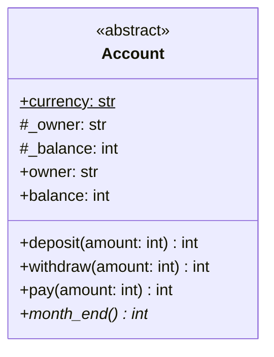
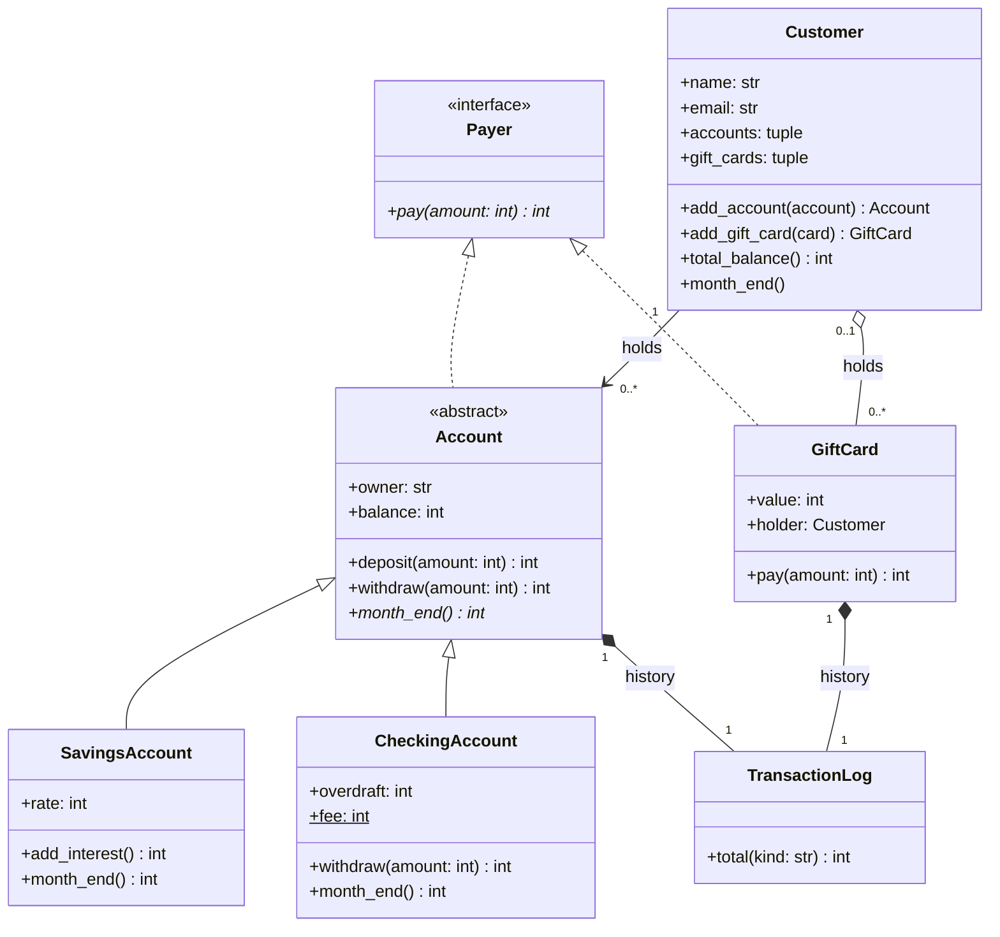
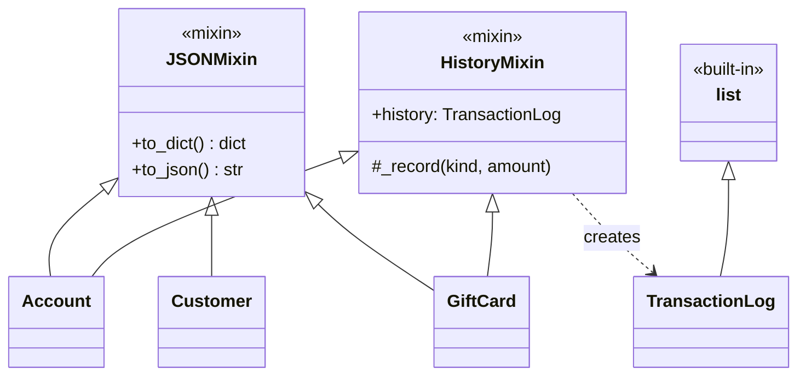
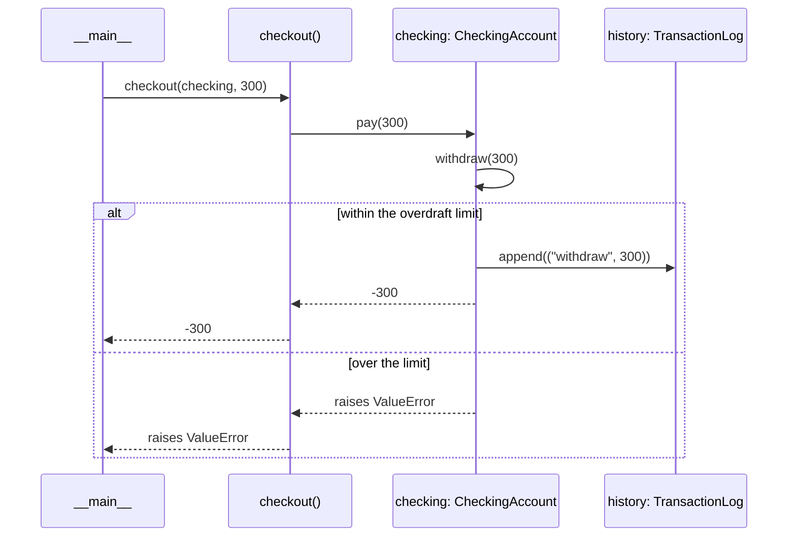
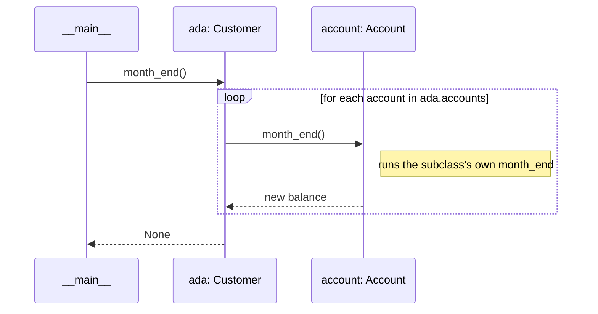
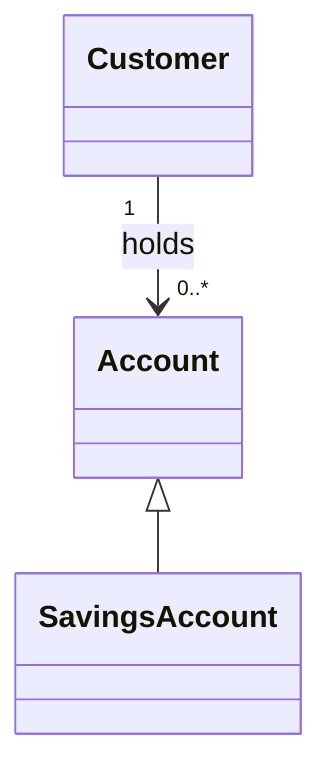

# Introduction to UML Modeling

<span class="badge badge--time">75 min</span>
<span class="badge badge--level">Object-Oriented Design</span>
<span class="badge">Needs: Abstract Classes & Interfaces</span>

The wallet now has eight classes and several kinds of relationship
between them. Reading 300 lines of Python is a slow way to understand
that. **UML**, the Unified Modeling Language, is the standard way
developers draw a design: boxes for classes, lines for relationships,
numbers for how many of each. In this tutorial you draw the wallet,
add the customer who owns it all, and write the diagrams as text with
**Mermaid**, so they live next to your code.

## Why this matters

A diagram is where design decisions are cheapest to change. Moving an
arrow takes a second; moving a class hierarchy after the code is
written takes a day. Teams sketch a design, discuss it in a pull
request or on a whiteboard, and only then write it.

Diagrams are also how you will read other people's systems: the
documentation of almost every framework, and the first phase of the
HBnB portfolio project, start with a class diagram. This page uses only
the parts of UML that working developers actually draw.

## Where we left off

<figure class="h-figure" markdown="0">
<svg viewBox="0 0 680 130" role="img" aria-labelledby="oop4-plan-title oop4-plan-desc">
<title id="oop4-plan-title">How the wallet grows across the module</title>
<desc id="oop4-plan-desc">Version 1, Classes: the Account class: done. Version 2, Inheritance: savings and checking accounts: done. Version 3, Abstract classes: contracts and mixins: done. Version 4, UML: drawing the design: this page. Version 5, Patterns: Factory, Observer and Decorator: coming next.</desc>
<defs><marker id="oop4-plan-arrow" viewBox="0 0 10 10" refX="9" refY="5" markerWidth="5" markerHeight="5" orient="auto-start-reverse"><path d="M0 0 L10 5 L0 10 z" fill="var(--h-fig-line)"/></marker></defs>
<rect x="3" y="20" width="122" height="90" rx="10" fill="var(--h-fig-box)" stroke="var(--h-fig-text)" stroke-width="1.5"/>
<rect x="141" y="20" width="122" height="90" rx="10" fill="var(--h-fig-box)" stroke="var(--h-fig-text)" stroke-width="1.5"/>
<rect x="279" y="20" width="122" height="90" rx="10" fill="var(--h-fig-box)" stroke="var(--h-fig-text)" stroke-width="1.5"/>
<rect x="417" y="20" width="122" height="90" rx="10" fill="var(--h-cherry)"/>
<rect x="555" y="20" width="122" height="90" rx="10" fill="var(--h-fig-box)" stroke="var(--h-fig-line)" stroke-dasharray="5 4"/>
<g text-anchor="middle">
<text x="64" y="44" font-size="11" font-weight="700" fill="var(--h-fig-muted)">v1 · DONE</text>
<text x="64" y="70" font-size="14" font-weight="700" fill="var(--h-fig-text)">Classes</text>
<text x="64" y="90" font-size="11" fill="var(--h-fig-muted)" font-family="var(--md-code-font-family, monospace)">Account</text>
<text x="202" y="44" font-size="11" font-weight="700" fill="var(--h-fig-muted)">v2 · DONE</text>
<text x="202" y="70" font-size="14" font-weight="700" fill="var(--h-fig-text)">Inheritance</text>
<text x="202" y="90" font-size="11" fill="var(--h-fig-muted)">savings, checking</text>
<text x="340" y="44" font-size="11" font-weight="700" fill="var(--h-fig-muted)">v3 · DONE</text>
<text x="340" y="70" font-size="14" font-weight="700" fill="var(--h-fig-text)">Abstract</text>
<text x="340" y="90" font-size="11" fill="var(--h-fig-muted)">contracts, mixins</text>
<text x="478" y="44" font-size="11" font-weight="700" fill="#ffffff" opacity="0.85">v4 · THIS PAGE</text>
<text x="478" y="70" font-size="14" font-weight="700" fill="#ffffff">UML</text>
<text x="478" y="90" font-size="11" fill="#ffffff" opacity="0.9">draw the design</text>
<text x="616" y="44" font-size="11" font-weight="700" fill="var(--h-fig-muted)">v5</text>
<text x="616" y="70" font-size="14" font-weight="700" fill="var(--h-fig-text)">Patterns</text>
<text x="616" y="90" font-size="11" fill="var(--h-fig-muted)">three patterns</text>
</g>
<g stroke="var(--h-fig-line)" stroke-width="2" marker-end="url(#oop4-plan-arrow)">
<line x1="127" y1="65" x2="138" y2="65"/>
<line x1="265" y1="65" x2="276" y2="65"/>
<line x1="403" y1="65" x2="414" y2="65"/>
<line x1="541" y1="65" x2="552" y2="65"/>
</g>
</svg>
</figure>

Start from version 3, or the tag
[`v3-abstract`](https://github.com/evisp/oop-wallet/tree/v3-abstract).
The wallet has one requirement that is still missing: the **customer**.
So far an account's owner is just a name. Here is the full description
of the system as it should be at the end of this page:

> A **customer** has a name and an email address. A customer can hold
> any number of **accounts**, and every account belongs to exactly one
> customer. An account is either a **savings account**, which earns
> monthly interest, or a **checking account**, which may go overdrawn
> up to a limit. Customers can also hold **gift cards**. A gift card can
> be sold before anyone holds it, but once it is given to a customer it
> belongs to that one customer only. Both accounts and gift cards can
> **pay**, and both keep a **history** of every transaction.

## Step 1: Extract classes, attributes and methods from text

You did a small version of this in the first tutorial. Now do it
properly, on the full description. Read it once and mark three kinds
of word:

- **Nouns** are candidate **classes** or **attributes**.
- **Verbs** are candidate **methods**.
- **Rules**, especially ones with numbers or words like *any*, *exactly*
  or *only*, become **multiplicities** and **checks**.

Then decide what each candidate really is. Not every noun deserves a
class.

| Candidate | Decision | Why |
|---|---|---|
| customer | class `Customer` | has its own data and behaviour |
| name, email address | attributes of `Customer` | simple values, no behaviour of their own |
| account | abstract class `Account` | "either a savings or a checking account": never a plain one |
| savings account, checking account | subclasses | each *is an* account with its own rule |
| gift card | class `GiftCard` | can pay, but is not an account |
| pay | interface `Payer` | a capability shared by unrelated classes |
| history | class `TransactionLog` | a collection with its own rules |
| transaction | a `(kind, amount)` tuple | only data, no behaviour yet |
| system, wallet | not a class | that is the whole program, not a thing inside it |
| monthly interest, overdraft limit | attributes `rate`, `overdraft` | numbers that configure a class |
| holds, belongs to | relationships | lines between classes, not classes |

The last rows are the useful ones. A word like *wallet* names the
system itself. *Holds* and *belongs to* are not things at all but
connections, and they become the lines of the diagram.

## Step 2: Draw a class

A class in UML is a box with three compartments: the **name**, the
**attributes**, and the **methods**. This is `Account` from version 3,
written in Mermaid:

```text
classDiagram
    class Account {
        <<abstract>>
        +currency: str$
        #_owner: str
        #_balance: int
        +owner: str
        +balance: int
        +deposit(amount: int) int
        +withdraw(amount: int) int
        +pay(amount: int) int
        +month_end()* int
    }
```

And this is what it draws:



Each line uses a small set of symbols:

| Symbol | Meaning | In the wallet |
|---|---|---|
| `+` | public: part of the interface | `+deposit(...)`, `+balance` |
| `-` | private | Python's `__name`; not used in the wallet |
| `#` | protected: for the class and its subclasses | Python's `_name`, such as `#_balance` |
| `name: type` | an attribute and its type | `+owner: str` |
| `method(params) type` | a method and what it returns | `+withdraw(amount: int) int` |
| `$` at the end | static: belongs to the class | `+currency: str$` |
| `*` at the end | abstract: subclasses must define it | `+month_end()* int` |
| `<<...>>` | a stereotype: what kind of class | `<<abstract>>`, `<<interface>>` |

You do not have to show everything. A diagram for discussing the
design usually shows only the public interface; a diagram for
explaining the implementation may show internal attributes too.
Choose for the reader.

## Step 3: Model relationships between classes

Classes rarely stand alone. UML has six kinds of line, and the wallet
already uses all of them.

<figure class="h-figure" markdown="0">
<svg viewBox="0 0 680 306" role="img" aria-labelledby="uml-rel-title uml-rel-desc">
<title id="uml-rel-title">The six UML relationships, with wallet examples</title>
<desc id="uml-rel-desc">Inheritance: a solid line with a hollow triangle, SavingsAccount to Account, meaning is a. Realization: a dashed line with a hollow triangle, GiftCard to Payer, meaning implements. Association: a solid line with an open arrow, Customer to Account, meaning knows and uses. Aggregation: a solid line with a hollow diamond at Customer, to GiftCard, meaning has, and the part can exist alone. Composition: a solid line with a filled diamond at Account, to TransactionLog, meaning owns, and the part lives and dies with it. Dependency: a dashed line with an open arrow, checkout to Payer, meaning uses briefly.</desc>
<g font-size="10.5" font-weight="700" fill="var(--h-fig-muted)">
<text x="140" y="14" text-anchor="end">FROM</text>
<text x="220" y="14" text-anchor="middle">LINE</text>
<text x="298" y="14">TO</text>
<text x="420" y="14">MEANING · MERMAID</text>
</g>
<g font-size="12.5" font-weight="700" fill="var(--h-fig-text)">
<text x="140" y="48" text-anchor="end">SavingsAccount</text><text x="298" y="48">Account</text>
<text x="140" y="94" text-anchor="end">GiftCard</text><text x="298" y="94">Payer</text>
<text x="140" y="140" text-anchor="end">Customer</text><text x="298" y="140">Account</text>
<text x="140" y="186" text-anchor="end">Customer</text><text x="298" y="186">GiftCard</text>
<text x="140" y="232" text-anchor="end">Account</text><text x="298" y="232">TransactionLog</text>
<text x="140" y="278" text-anchor="end">checkout</text><text x="298" y="278">Payer</text>
</g>
<g stroke="var(--h-fig-text)" stroke-width="1.6" fill="none">
<line x1="152" y1="44" x2="274" y2="44"/>
<polygon points="288,44 274,36 274,52" fill="var(--md-default-bg-color)"/>
<line x1="152" y1="90" x2="274" y2="90" stroke-dasharray="6 4"/>
<polygon points="288,90 274,82 274,98" fill="var(--md-default-bg-color)"/>
<line x1="152" y1="136" x2="287" y2="136"/>
<polyline points="275,129 288,136 275,143"/>
<polygon points="152,182 165,175 178,182 165,189" fill="var(--md-default-bg-color)"/>
<line x1="178" y1="182" x2="288" y2="182"/>
<polygon points="152,228 165,221 178,228 165,235" fill="var(--h-fig-text)"/>
<line x1="178" y1="228" x2="288" y2="228"/>
<line x1="152" y1="274" x2="287" y2="274" stroke-dasharray="6 4"/>
<polyline points="275,267 288,274 275,281"/>
</g>
<g font-size="12" font-weight="700" fill="var(--h-cherry)">
<text x="420" y="40">Inheritance: is a</text>
<text x="420" y="86">Realization: implements</text>
<text x="420" y="132">Association: knows, uses</text>
<text x="420" y="178">Aggregation: part can exist alone</text>
<text x="420" y="224">Composition: part dies with whole</text>
<text x="420" y="270">Dependency: uses briefly</text>
</g>
<g font-size="11" fill="var(--h-fig-muted)" font-family="var(--md-code-font-family, monospace)">
<text x="420" y="58">Account &lt;|-- SavingsAccount</text>
<text x="420" y="104">Payer &lt;|.. GiftCard</text>
<text x="420" y="150">Customer --&gt; Account</text>
<text x="420" y="196">Customer o-- GiftCard</text>
<text x="420" y="242">Account *-- TransactionLog</text>
<text x="420" y="288">checkout ..&gt; Payer</text>
</g>
</svg>
</figure>

**Inheritance** and **realization** you already know: a solid line with
a hollow triangle means "is a", a dashed one means "implements an
interface". The triangle always points at the parent.

The other four are all forms of "has" or "uses", and the difference
between them is about **lifetime**:

- **Association**: one object keeps a reference to another and uses it.
  A customer knows their accounts.
- **Aggregation**, a hollow diamond on the side of the whole: a
  "has a" where the part can exist on its own. A gift card exists in
  the shop before any customer holds it.
- **Composition**, a filled diamond on the side of the whole: a "has a"
  where the part is created by the whole and goes with it. An account's
  history is created inside the account, and there is no history
  without its account.
- **Dependency**, a dashed arrow: something uses another class briefly,
  for example as a parameter, without keeping it. `checkout` uses a
  `Payer` only while it runs.

When you are unsure between association, aggregation and composition,
ask: *if the whole disappears, does the part disappear too?* Yes means
composition. No means aggregation or association, and plain
association is always a safe choice. The difference between those two
is a matter of emphasis, and many teams only draw plain association.

## Step 4: Determine multiplicity from system rules

A line says two classes are related. **Multiplicity** says how many: a
number, or a range, written at each end of the line.

| Notation | Means | From a rule like |
|---|---|---|
| `1` | exactly one | "belongs to exactly one customer" |
| `0..1` | zero or one | "may have", "at most one" |
| `0..*` or `*` | any number, including none | "any number of", "can hold" |
| `1..*` | at least one | "one or more", "must have" |

Read each relationship **in both directions**, one sentence per end.
Take customers and accounts:

> A customer can hold any number of accounts. → **0..\*** next to `Account`<br>
> Every account belongs to exactly one customer. → **1** next to `Customer`

Then gift cards:

> A customer can hold any number of gift cards. → **0..\*** next to `GiftCard`<br>
> A gift card can be unsold, or held by one customer only. → **0..1** next to `Customer`

The trick is to put each number at the **far** end: it answers "for one
of *these*, how many of *those*?" In Mermaid, the numbers go in quotes
on either side of the line:

```text
Customer "1" --> "0..*" Account : holds
Customer "0..1" o-- "0..*" GiftCard : holds
```

Multiplicity is the part of a diagram that turns most directly into
code. Every `1` and `0..1` is a check something must perform, which you
will write in Step 6.

## Step 5: Represent the system with class diagrams

Here is the whole domain, with the new `Customer`, every relationship
and every multiplicity:



This diagram leaves out the mixins on purpose. They are about *how*
the code shares behaviour, not about *what* the wallet models, and
adding them would double the number of lines. They get a small diagram
of their own:



That is a habit worth keeping: **one diagram per question.** "What does
the system model?" and "how is the code organised?" are different
questions, and a single diagram that answers both is hard to read.

## Step 6: From the diagram to code

The diagram has one class that does not exist yet. Write `Customer`
from it: the attributes and methods come straight from its box, and
each multiplicity becomes a rule.

```python
class Customer(JSONMixin):
    """A wallet customer, who can hold accounts and gift cards."""

    def __init__(self, name, email):
        """Create a customer with a name and an email address."""
        if not isinstance(name, str) or not name.strip():
            raise ValueError("name must be a non-empty string")
        if not isinstance(email, str) or "@" not in email:
            raise ValueError("email must contain @")
        self._name = name.strip()
        self._email = email.strip()
        self._accounts = []
        self._gift_cards = []

    @property
    def accounts(self):
        """The customer's accounts, as a tuple."""
        return tuple(self._accounts)

    def add_account(self, account):
        """Add an account this customer owns, and return it."""
        if not isinstance(account, Account):
            raise TypeError("account must be an Account")
        if account.owner != self._name:
            raise ValueError("account belongs to another customer")
        if account in self._accounts:
            raise ValueError("account already added")
        self._accounts.append(account)
        return account

    def add_gift_card(self, card):
        """Give this customer a gift card nobody else holds; return it."""
        if not isinstance(card, GiftCard):
            raise TypeError("card must be a GiftCard")
        if card.holder is not None:
            raise ValueError("gift card already has a holder")
        card._holder = self
        self._gift_cards.append(card)
        return card

    # name, email, gift_cards, total_balance, month_end,
    # __str__ and __repr__ are in the full code below
```

Trace each piece back to the diagram:

| In the diagram | In the code |
|---|---|
| `Customer "1" --> "0..*" Account` | a list, `_accounts`, that can hold any number, exposed as a tuple so nobody edits it from outside |
| the `1` next to `Customer` | `add_account` refuses an account whose owner is someone else |
| `Customer "0..1" o-- "0..*" GiftCard` | a list, `_gift_cards` |
| the `0..1` next to `Customer` | each card stores its `holder`; a card that already has one is refused |
| `+holder: Customer` in `GiftCard` | a new read-only property, set only by `add_gift_card` |

The `0..1` needed a change to `GiftCard`: to know whether it already
has a holder, the card must remember who that is. A relationship that
has to be checked from both ends usually needs a reference at both
ends. Notice too that `add_gift_card` sets `card._holder`, an internal
attribute of another class. Both classes live in the same module and
are designed together, which makes that acceptable here; across
modules you would add a proper method instead.

!!! note "A name is not an identity"

    `add_account` compares owner *names*, so two customers called Ada
    would be confused. Real systems give every customer a unique ID.
    The wallet keeps names to stay small, but that is the kind of
    weakness a diagram review is good at spotting.

```python
ada = Customer("Ada", "ada@example.com")
ada.add_account(SavingsAccount("Linus", 100))
# ValueError: account belongs to another customer
```

## Step 7: Model interactions with sequence diagrams

A class diagram shows **structure**: what exists and how it connects.
It says nothing about what happens *when* you call a method. For that,
UML has the **sequence diagram**: the objects across the top, time
running downwards, and one arrow per message.

Here is what happens when you run `checkout(checking, 300)`:



```text
sequenceDiagram
    participant M as __main__
    participant C as checkout()
    participant A as checking: CheckingAccount
    participant L as history: TransactionLog
    M->>C: checkout(checking, 300)
    C->>A: pay(300)
    A->>A: withdraw(300)
    alt within the overdraft limit
        A->>L: append(("withdraw", 300))
        A-->>C: -300
        C-->>M: -300
    else over the limit
        A-->>C: raises ValueError
        C-->>M: raises ValueError
    end
```

The parts:

- **Participants**, across the top: each one is an object, written
  `name: Class`, or a function. The vertical line below each is its
  **lifeline**.
- **`->>`**, a solid arrow, is a call. **`-->>`**, a dashed arrow, is
  the return value coming back.
- **An arrow to itself**, `A->>A`, is an object calling its own method:
  `pay` calls `withdraw`.
- **`alt ... else ... end`** shows alternatives, like an `if`. The
  condition goes in the label.

A loop has its own box. This is `ada.month_end()`, which runs every
account's rule:



The participant is drawn as `account: Account`, the abstract type,
because the customer does not know or care which subclass each account
is. The note says where polymorphism takes over. Use the same
technique to draw any loop over objects that share an interface.

A sequence diagram is for **one scenario**. Do not try to show every
path through the code in one drawing; draw the important scenarios,
one each.

## Step 8: Use Mermaid in practice

Mermaid diagrams are plain text, which is their biggest advantage: they
live in your repository, show up in diffs, and get reviewed in pull
requests like code.

- **GitHub** draws them in any Markdown file: a README, a `DESIGN.md`,
  an issue or a pull request. Put the diagram in a fenced code block
  marked `mermaid`.
- **This site** draws them the same way.
- **[mermaid.live](https://mermaid.live)** is an online editor that
  redraws as you type. Use it to sketch, then paste the text into your
  repository.

````markdown title="DESIGN.md"
# Design


````

The companion repository now has a
[`DESIGN.md`](https://github.com/evisp/oop-wallet/blob/v4-uml/DESIGN.md)
with every diagram on this page, drawn by GitHub.

!!! ai "AI in the loop"

    Assistants are good at turning code into Mermaid. Try it the other
    way round: draw your own class diagram from the description first,
    then ask an assistant to generate one from `wallet.py`, and
    *compare*. Where they differ, one of the two is wrong: your
    understanding, or the code. Also ask it to check your
    multiplicities against the written rules, one sentence at a time.

## The code so far

This is version 4 of the wallet, tagged
[`v4-uml`](https://github.com/evisp/oop-wallet/tree/v4-uml). The changes
from version 3 are the new `Customer` class, the `holder` of a gift
card, and the demo at the bottom.

??? example "wallet.py · version 4"

    ```python title="wallet.py"
    #!/usr/bin/env python3
    """A small digital wallet, built up across the OOP tutorials.

    Version 4: Introduction to UML Modeling.
    """
    import json
    from abc import ABC, abstractmethod


    def _check_amount(amount):
        """Raise if amount is not a positive whole number."""
        if isinstance(amount, bool) or not isinstance(amount, int):
            raise TypeError("amount must be an integer")
        if amount <= 0:
            raise ValueError("amount must be positive")


    class TransactionLog(list):
        """A list that only accepts (kind, amount) transaction entries."""

        KINDS = ("deposit", "withdraw", "payment", "interest", "fee")

        def __init__(self, entries=()):
            super().__init__()
            self.extend(entries)

        def append(self, entry):
            """Add one entry, after checking it."""
            self._check(entry)
            super().append(entry)

        def extend(self, entries):
            """Add several entries; check them all before adding any."""
            entries = list(entries)
            for entry in entries:
                self._check(entry)
            super().extend(entries)

        def total(self, kind):
            """Return the sum of all amounts of one kind."""
            return sum(amount for k, amount in self if k == kind)

        def _check(self, entry):
            if not isinstance(entry, tuple) or len(entry) != 2:
                raise TypeError("entry must be a (kind, amount) tuple")
            kind, amount = entry
            if kind not in self.KINDS:
                raise ValueError(f"unknown kind: {kind!r}")
            _check_amount(amount)


    class HistoryMixin:
        """Give a class a transaction history."""

        def _record(self, kind, amount):
            """Add one entry to this object's history."""
            if "_history" not in vars(self):
                self._history = TransactionLog()
            self._history.append((kind, amount))

        @property
        def history(self):
            """A copy of the transaction history."""
            return TransactionLog(vars(self).get("_history", ()))


    class JSONMixin:
        """Give a class a dictionary and JSON form of its simple attributes."""

        def to_dict(self):
            """Return the type and simple attributes as a dictionary."""
            data = {"type": type(self).__name__}
            for name, value in vars(self).items():
                if isinstance(value, (str, int, float, bool)):
                    data[name.lstrip("_")] = value
            return data

        def to_json(self):
            """Return to_dict() as a JSON string."""
            return json.dumps(self.to_dict())


    class Payer(ABC):
        """Interface: anything that can pay an amount."""

        @abstractmethod
        def pay(self, amount):
            """Pay amount, or raise ValueError; return what is left."""


    class Account(HistoryMixin, JSONMixin, Payer):
        """Abstract base for wallet accounts holding money, in whole lek."""

        currency = "ALL"

        def __init__(self, owner, balance=0):
            """Create an account for owner with an opening balance."""
            self.owner = owner
            if isinstance(balance, bool) or not isinstance(balance, int):
                raise TypeError("balance must be an integer")
            if balance < 0:
                raise ValueError("balance must not be negative")
            self._balance = balance
            if balance:
                self._record("deposit", balance)

        @property
        def owner(self):
            """The account holder's name."""
            return self._owner

        @owner.setter
        def owner(self, value):
            if not isinstance(value, str):
                raise TypeError("owner must be a string")
            if not value.strip():
                raise ValueError("owner must not be empty")
            self._owner = value.strip()

        @property
        def balance(self):
            """The current balance. Read-only: use deposit and withdraw."""
            return self._balance

        def deposit(self, amount):
            """Add amount to the balance and return the new balance."""
            _check_amount(amount)
            self._balance += amount
            self._record("deposit", amount)
            return self._balance

        def withdraw(self, amount):
            """Take amount from the balance and return the new balance."""
            _check_amount(amount)
            if amount > self._balance:
                raise ValueError("insufficient funds")
            self._balance -= amount
            self._record("withdraw", amount)
            return self._balance

        def pay(self, amount):
            """Pay amount from this account; return the new balance."""
            return self.withdraw(amount)

        @abstractmethod
        def month_end(self):
            """Apply end-of-month rules and return the new balance."""

        def __str__(self):
            return f"{self.owner}: {self.balance} {self.currency}"

        def __repr__(self):
            return (f"{type(self).__name__}(owner={self.owner!r}, "
                    f"balance={self.balance})")


    class SavingsAccount(Account):
        """An account that earns interest every month."""

        def __init__(self, owner, balance=0, rate=1):
            """Create a savings account; rate is monthly interest in percent."""
            super().__init__(owner, balance)
            if isinstance(rate, bool) or not isinstance(rate, int):
                raise TypeError("rate must be an integer")
            if not 0 <= rate <= 10:
                raise ValueError("rate must be between 0 and 10")
            self._rate = rate

        @property
        def rate(self):
            """Monthly interest rate, in whole percent."""
            return self._rate

        def add_interest(self):
            """Add this month's interest and return the amount added."""
            interest = self._balance * self._rate // 100
            if interest > 0:
                self._balance += interest
                self._record("interest", interest)
            return interest

        def month_end(self):
            """Add this month's interest and return the new balance."""
            self.add_interest()
            return self._balance

        def __repr__(self):
            return (f"{type(self).__name__}(owner={self.owner!r}, "
                    f"balance={self.balance}, rate={self.rate})")


    class CheckingAccount(Account):
        """An everyday account that may go below zero, up to a limit."""

        fee = 100

        def __init__(self, owner, balance=0, overdraft=0):
            """Create a checking account with an overdraft limit."""
            super().__init__(owner, balance)
            if isinstance(overdraft, bool) or not isinstance(overdraft, int):
                raise TypeError("overdraft must be an integer")
            if overdraft < 0:
                raise ValueError("overdraft must not be negative")
            self._overdraft = overdraft

        @property
        def overdraft(self):
            """How far below zero the balance may go."""
            return self._overdraft

        def withdraw(self, amount):
            """Take amount out, letting the balance go down to -overdraft."""
            _check_amount(amount)
            if self._balance - amount < -self._overdraft:
                raise ValueError("overdraft limit exceeded")
            self._balance -= amount
            self._record("withdraw", amount)
            return self._balance

        def month_end(self):
            """Charge the monthly fee if overdrawn; return the new balance."""
            if self._balance < 0:
                self._balance -= self.fee
                self._record("fee", self.fee)
            return self._balance

        def __str__(self):
            return f"{super().__str__()} (overdraft {self.overdraft})"

        def __repr__(self):
            return (f"{type(self).__name__}(owner={self.owner!r}, "
                    f"balance={self.balance}, overdraft={self.overdraft})")


    class GiftCard(HistoryMixin, JSONMixin, Payer):
        """A prepaid card with a fixed value. It is not an account."""

        currency = "ALL"

        def __init__(self, code, value):
            """Create a gift card with a code and a starting value."""
            if not isinstance(code, str) or not code.strip():
                raise ValueError("code must be a non-empty string")
            _check_amount(value)
            self._code = code.strip()
            self._value = value
            self._holder = None

        @property
        def holder(self):
            """The customer holding this card, or None."""
            return self._holder

        @property
        def value(self):
            """What is left on the card."""
            return self._value

        def pay(self, amount):
            """Pay amount from the card; return the value left."""
            _check_amount(amount)
            if amount > self._value:
                raise ValueError("not enough value on the card")
            self._value -= amount
            self._record("payment", amount)
            return self._value

        def __str__(self):
            return f"Gift card {self._code}: {self.value} {self.currency}"

        def __repr__(self):
            return f"GiftCard(code={self._code!r}, value={self.value})"


    class Customer(JSONMixin):
        """A wallet customer, who can hold accounts and gift cards."""

        def __init__(self, name, email):
            """Create a customer with a name and an email address."""
            if not isinstance(name, str) or not name.strip():
                raise ValueError("name must be a non-empty string")
            if not isinstance(email, str) or "@" not in email:
                raise ValueError("email must contain @")
            self._name = name.strip()
            self._email = email.strip()
            self._accounts = []
            self._gift_cards = []

        @property
        def name(self):
            """The customer's name."""
            return self._name

        @property
        def email(self):
            """The customer's email address."""
            return self._email

        @property
        def accounts(self):
            """The customer's accounts, as a tuple."""
            return tuple(self._accounts)

        @property
        def gift_cards(self):
            """The customer's gift cards, as a tuple."""
            return tuple(self._gift_cards)

        def add_account(self, account):
            """Add an account this customer owns, and return it."""
            if not isinstance(account, Account):
                raise TypeError("account must be an Account")
            if account.owner != self._name:
                raise ValueError("account belongs to another customer")
            if account in self._accounts:
                raise ValueError("account already added")
            self._accounts.append(account)
            return account

        def add_gift_card(self, card):
            """Give this customer a gift card nobody else holds; return it."""
            if not isinstance(card, GiftCard):
                raise TypeError("card must be a GiftCard")
            if card.holder is not None:
                raise ValueError("gift card already has a holder")
            card._holder = self
            self._gift_cards.append(card)
            return card

        def total_balance(self):
            """Return the sum of all account balances."""
            return sum(account.balance for account in self._accounts)

        def month_end(self):
            """Run the end-of-month rules on every account."""
            for account in self._accounts:
                account.month_end()

        def __str__(self):
            return (f"{self.name} <{self.email}>: "
                    f"accounts: {len(self._accounts)}, "
                    f"gift cards: {len(self._gift_cards)}")

        def __repr__(self):
            return f"Customer(name={self.name!r}, email={self.email!r})"


    def checkout(payer, amount):
        """Charge amount to anything that can pay; return what it returns."""
        return payer.pay(amount)


    if __name__ == "__main__":
        ada = Customer("Ada", "ada@example.com")
        savings = ada.add_account(SavingsAccount("Ada", 1000, rate=2))
        checking = ada.add_account(CheckingAccount("Ada", overdraft=500))
        card = ada.add_gift_card(GiftCard("HB-2026", 300))

        checkout(checking, 300)
        checkout(card, 120)
        ada.month_end()

        print(ada)
        for item in ada.accounts + ada.gift_cards:
            print(item)
        print(f"Total in accounts: {ada.total_balance()} {Account.currency}")
    ```

```bash
./wallet.py
```

```
Ada <ada@example.com>: accounts: 2, gift cards: 1
Ada: 1020 ALL
Ada: -400 ALL (overdraft 500)
Gift card HB-2026: 180 ALL
Total in accounts: 620 ALL
```

## When something goes wrong

??? note "The diagram does not draw; the page shows the Mermaid text"

    The code block must be marked exactly `mermaid` on its first line,
    and the first line inside must name the diagram type:
    `classDiagram` or `sequenceDiagram`. On mermaid.live, the error
    message points to the line that failed.

??? note "`Parse error` on a relationship line"

    Multiplicities need double quotes, `"0..*"`, and the arrow must be
    one of the forms in the table, with no spaces inside it:
    `<|--`, `<|..`, `-->`, `o--`, `*--`, `..>`.

??? note "A member shows up in the wrong compartment"

    Mermaid decides by the brackets: a line with `(...)` is a method,
    anything else is an attribute.

??? note "I don't know whether a relationship is aggregation or composition"

    Ask whether the part can exist without the whole. If you are still
    unsure, draw a plain association and add a multiplicity. That is
    never wrong, only less specific.

## Explain it to someone

- [ ] How to extract classes, attributes and methods from a written description
- [ ] Why some nouns become attributes, relationships, or nothing at all
- [ ] What the three compartments of a class box hold, and what `+`, `#`, `$` and `*` mean
- [ ] The six kinds of relationship, and how to choose between association, aggregation and composition
- [ ] How to turn a rule such as "belongs to exactly one" into a multiplicity
- [ ] Why each multiplicity goes at the far end of the line
- [ ] How a multiplicity becomes a check in code
- [ ] What a sequence diagram shows that a class diagram does not
- [ ] How calls, returns, `alt` and `loop` appear in a sequence diagram
- [ ] How to write both kinds of diagram in Mermaid, and where they render

## Quick reference

| Mermaid | Draws |
|---|---|
| `classDiagram` / `sequenceDiagram` | Start a diagram of that type |
| `class Name { +attr: type  +method() type }` | A class box |
| `<<interface>>`, `<<abstract>>`, `<<mixin>>` | A stereotype, inside the class |
| `A <|-- B` / `A <|.. B` | B inherits from A / B implements A |
| `A --> B`, `A o-- B`, `A *-- B`, `A ..> B` | Association, aggregation, composition, dependency |
| `A "1" --> "0..*" B : label` | A relationship with multiplicities and a name |
| `participant X as name: Class` | A sequence-diagram participant |
| `X->>Y: call()` / `Y-->>X: result` | A call / a return |
| `alt cond ... else ... end`, `loop text ... end` | Alternatives / a loop |

## Next

The wallet's design is now on paper, and you can see where it is
rigid: every new account type means new `SavingsAccount(...)`-style
calls scattered through the code, and every new feature means another
subclass. Design patterns are the standard answers to exactly these
problems.

[Introduction to Design Patterns](design-patterns.md){ .h-button }
