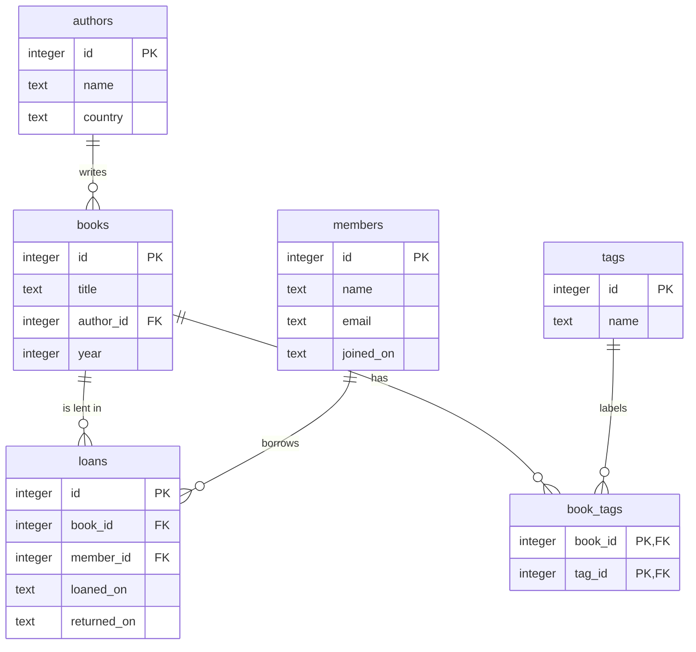

# Database Design & Normalization

<span class="badge badge--time">90 min</span>
<span class="badge badge--level">Data & APIs</span>
<span class="badge">Needs: SQL: Joins & Relationships</span>

In the last tutorial the library already had a good schema. This time
you start where real projects often start: one big table copied from a
spreadsheet. You find the problems it causes, fix them one rule at a
time with **normalization**, and move the data into the clean schema
without losing a row.

## Why this matters

A badly designed table works on day one. The trouble comes later: one
customer with two email addresses, a product that cannot be added until
someone orders it, history that disappears with a single delete. Those
bugs live in the **design**, so no amount of careful code fixes them.
Learning to see them before they happen is one of the most valuable
skills in back-end work, and it is exactly what you will need to design
the tables of your own projects.

## Before you start

Download the spreadsheet data and load it into a new database,
`design.db`:

```bash
cd ~/library
curl -O https://evisp.github.io/augmented_software_engineering/assets/sql/loans_sheet.sql
sqlite3 design.db < loans_sheet.sql
sqlite3 design.db
```

Or download
[loans_sheet.sql](../../assets/sql/loans_sheet.sql){ download="loans_sheet.sql" }
from the browser. It creates two tables: `loans_sheet`, used in the
steps, and `orders_sheet`, for the practice set. As in the last
tutorial, the outputs use `.headers on`, `.mode box` and
`PRAGMA foreign_keys = ON`.

## Step 1: A spreadsheet in a database

The library used to track loans in a spreadsheet, one line per loan,
with everything about the loan on that line. Imported as it was, it
looks like this:

```sql
SELECT * FROM loans_sheet LIMIT 6;
```

```text
┌────────────┬─────────────┬─────────────────┬────────────────────┬──────────────────────┬──────────────────┬────────────────┬───────────────────┐
│ loaned_on  │ returned_on │   member_name   │    member_email    │      book_title      │      author      │ author_country │       tags        │
├────────────┼─────────────┼─────────────────┼────────────────────┼──────────────────────┼──────────────────┼────────────────┼───────────────────┤
│ 2026-09-02 │ 2026-09-16  │ Arta Hoxha      │ arta@example.com   │ Nineteen Eighty-Four │ George Orwell    │ United Kingdom │ classic, dystopia │
│ 2026-09-05 │ 2026-09-30  │ Besnik Krasniqi │ besnik@example.com │ Dune                 │ Frank Herbert    │ United States  │ classic, sci-fi   │
│ 2026-09-18 │ 2026-10-01  │ Arta Hoxha      │ arta@example.com   │ Kronikë në gur       │ Ismail Kadare    │ Albania        │ albanian          │
│ 2026-09-20 │ 2026-10-04  │ Drita Leka      │ drita@example.com  │ The Hobbit           │ J. R. R. Tolkien │ United Kingdom │ classic, fantasy  │
│ 2026-09-25 │             │ Erion Shehu     │ erion@example.com  │ Pride and Prejudice  │ Jane Austen      │ United Kingdom │ classic           │
│ 2026-10-01 │ 2026-10-12  │ Besnik Krasniqi │ besnik@example.com │ Nineteen Eighty-Four │ George Orwell    │ UK             │ classic, dystopia │
└────────────┴─────────────┴─────────────────┴────────────────────┴──────────────────────┴──────────────────┴────────────────┴───────────────────┘
```

It is easy to read, and for a while it works. But look at how often the
same facts repeat: Arta's email on every one of her loans, Orwell's
country on every loan of every Orwell book. And one row already
disagrees with the others: `UK` instead of `United Kingdom`.

## Step 2: Three anomalies

Repeated facts cause three kinds of bugs, called **anomalies**. Each
demo below runs inside a transaction and ends with `ROLLBACK`, so the
sheet stays as it was.

**Update anomaly: a change must be made in many rows.** Arta has a new
email. Whoever updates the sheet changes it on her latest loan only, and
now the database holds two emails for one person:

```sql
BEGIN;
UPDATE loans_sheet SET member_email = 'arta.hoxha@example.com'
WHERE loaned_on = '2026-10-22';
SELECT DISTINCT member_name, member_email FROM loans_sheet
WHERE member_name = 'Arta Hoxha';
ROLLBACK;
```

```text
┌─────────────┬────────────────────────┐
│ member_name │      member_email      │
├─────────────┼────────────────────────┤
│ Arta Hoxha  │ arta@example.com       │
│ Arta Hoxha  │ arta.hoxha@example.com │
└─────────────┴────────────────────────┘
```

The `UK` row is the same bug, already in the data:

```sql
SELECT DISTINCT author, author_country FROM loans_sheet
WHERE author = 'George Orwell';
```

```text
┌───────────────┬────────────────┐
│    author     │ author_country │
├───────────────┼────────────────┤
│ George Orwell │ United Kingdom │
│ George Orwell │ UK             │
└───────────────┴────────────────┘
```

**Insert anomaly: a fact cannot be stored without another fact.** Lea
joins the library but has not borrowed anything yet. The only way to
record her is a "loan" with no book, which every count of loans then
gets wrong:

```sql
BEGIN;
INSERT INTO loans_sheet (member_name, member_email)
VALUES ('Lea Marku', 'lea@example.com');
SELECT COUNT(*) AS loans FROM loans_sheet;
ROLLBACK;
```

```text
┌───────┐
│ loans │
├───────┤
│ 13    │
└───────┘
```

The same goes for a new book on the shelf: until someone borrows it,
there is nowhere to write its title and author.

**Delete anomaly: removing one fact removes others.** *Pride and
Prejudice* has been borrowed once. Delete that loan, and the library
forgets the book, and Jane Austen, entirely:

```sql
BEGIN;
DELETE FROM loans_sheet WHERE book_title = 'Pride and Prejudice';
SELECT COUNT(*) AS austen_rows FROM loans_sheet WHERE author = 'Jane Austen';
ROLLBACK;
```

```text
┌─────────────┐
│ austen_rows │
├─────────────┤
│ 0           │
└─────────────┘
```

All three have the same cause: **one table holds facts about several
different things**, members, books, authors and loans. Normalization is
the process of splitting it so that each fact is stored exactly once.

## Step 3: Keys and dependencies

To split a table well, you need two ideas.

A **candidate key** is a set of columns whose values identify each row,
with nothing extra. In the sheet, one loan is identified by **who**
borrowed **which** book **when**: `member_email`, `book_title` and
`loaned_on` together. A key made of several columns is a **composite
key**. Check that no two rows share it:

```sql
SELECT member_email, book_title, loaned_on, COUNT(*) AS rows
FROM loans_sheet
GROUP BY member_email, book_title, loaned_on
HAVING COUNT(*) > 1;
```

It returns no rows, so no duplicates. A query can only show that the
current data has no duplicates, though; a key is a **rule** for all data,
now and later. Could the same member borrow the same book twice? Yes,
on different days, so `loaned_on` has to be part of the key.

A **functional dependency** says that one column decides another. If
you know a member's email, you know their name: `member_email` →
`member_name`. Draw every dependency in the sheet, and the problems
light up:

<figure class="h-figure" markdown="0">
<svg viewBox="0 0 680 254" role="img" aria-labelledby="dd-dep-title dd-dep-desc">
<title id="dd-dep-title">What depends on what in the loans sheet</title>
<desc id="dd-dep-desc">member_email decides member_name, which depends on only part of the key. book_title decides author, and author decides author_country: part of the key, then a chain. book_title also decides tags, but tags holds a list in one cell. Only returned_on needs the whole key: member_email, book_title and loaned_on.</desc>
<defs><marker id="dd-dep-arrow" viewBox="0 0 10 10" refX="9" refY="5" markerWidth="7" markerHeight="7" orient="auto-start-reverse"><path d="M0 0 L10 5 L0 10 z" fill="var(--h-fig-text)"/></marker></defs>
<g font-family="var(--md-code-font-family, monospace)" font-size="12" text-anchor="middle">
<rect x="3" y="20" width="130" height="34" rx="7" fill="var(--h-fig-box)" stroke="var(--h-cherry)" stroke-width="2"/><text x="68" y="42" fill="var(--h-fig-text)" font-weight="700">member_email</text>
<rect x="163" y="20" width="120" height="34" rx="7" fill="var(--h-fig-box)" stroke="var(--h-fig-line)"/><text x="223" y="42" fill="var(--h-fig-text)">member_name</text>
<rect x="3" y="80" width="130" height="34" rx="7" fill="var(--h-fig-box)" stroke="var(--h-cherry)" stroke-width="2"/><text x="68" y="102" fill="var(--h-fig-text)" font-weight="700">book_title</text>
<rect x="163" y="80" width="120" height="34" rx="7" fill="var(--h-fig-box)" stroke="var(--h-fig-line)"/><text x="223" y="102" fill="var(--h-fig-text)">author</text>
<rect x="313" y="80" width="130" height="34" rx="7" fill="var(--h-fig-box)" stroke="var(--h-fig-line)"/><text x="378" y="102" fill="var(--h-fig-text)">author_country</text>
<rect x="3" y="140" width="130" height="34" rx="7" fill="var(--h-fig-box)" stroke="var(--h-cherry)" stroke-width="2"/><text x="68" y="162" fill="var(--h-fig-text)" font-weight="700">book_title</text>
<rect x="163" y="140" width="120" height="34" rx="7" fill="var(--h-fig-box)" stroke="var(--h-cherry)" stroke-width="2" stroke-dasharray="5 3"/><text x="223" y="162" fill="var(--h-cherry)" font-weight="700">tags: a list</text>
<rect x="3" y="200" width="250" height="34" rx="7" fill="var(--h-cherry)"/><text x="128" y="222" fill="#ffffff" font-weight="700">email + title + loaned_on</text>
<rect x="283" y="200" width="120" height="34" rx="7" fill="var(--h-fig-box)" stroke="var(--h-fig-line)"/><text x="343" y="222" fill="var(--h-fig-text)">returned_on</text>
</g>
<g stroke="var(--h-fig-text)" stroke-width="1.8" marker-end="url(#dd-dep-arrow)">
<line x1="135" y1="37" x2="160" y2="37"/><line x1="135" y1="97" x2="160" y2="97"/><line x1="285" y1="97" x2="310" y2="97"/><line x1="135" y1="157" x2="160" y2="157"/><line x1="255" y1="217" x2="280" y2="217"/>
</g>
<g font-size="11.5">
<text x="470" y="34" font-weight="700" fill="var(--h-cherry)">Part of the key → 2NF</text><text x="470" y="49" fill="var(--h-fig-muted)">a member fact: own table</text>
<text x="470" y="94" font-weight="700" fill="var(--h-cherry)">Part of the key, then a chain</text><text x="470" y="109" fill="var(--h-fig-muted)">→ 2NF and 3NF: books, authors</text>
<text x="470" y="154" font-weight="700" fill="var(--h-cherry)">Several values in one cell</text><text x="470" y="169" fill="var(--h-fig-muted)">→ 1NF: one row per tag</text>
<text x="470" y="214" font-weight="700" fill="var(--h-fig-text)">Needs the whole key</text><text x="470" y="229" fill="var(--h-fig-muted)">a loan fact: stays in loans</text>
</g>
</svg>
</figure>

Only `returned_on` truly belongs to the loan. Everything else is a fact
about a member, a book or an author that happens to be copied onto the
loan. The three **normal forms** turn that picture into rules.

## Step 4: First normal form

**1NF: every cell holds one value, and every row is unique.** The
`tags` column breaks it: `'classic, dystopia'` is a list. To SQL, a list
in a cell is just a string, so you cannot work with the tags inside it.
Group by tag, and you get combinations instead:

```sql
SELECT tags, COUNT(*) AS loans FROM loans_sheet GROUP BY tags;
```

```text
┌───────────────────┬───────┐
│       tags        │ loans │
├───────────────────┼───────┤
│ albanian          │ 3     │
│ classic           │ 1     │
│ classic, albanian │ 1     │
│ classic, dystopia │ 3     │
│ classic, fantasy  │ 2     │
│ classic, sci-fi   │ 2     │
└───────────────────┴───────┘
```

`LIKE` can find a tag inside the string, but it is fragile: searching
for `'%fi%'` would match `sci-fi` and also any future `fiction`.

```sql
SELECT COUNT(*) AS loans FROM loans_sheet WHERE tags LIKE '%classic%';
```

```text
┌───────┐
│ loans │
├───────┤
│ 9     │
└───────┘
```

The fix is **one row per value**:

<figure class="h-figure" markdown="0">
<svg viewBox="0 0 680 160" role="img" aria-labelledby="dd-1nf-title dd-1nf-desc">
<title id="dd-1nf-title">From a list in a cell to one row per tag</title>
<desc id="dd-1nf-desc">Before: Dune has the tags classic, sci-fi in one cell, and The Hobbit has classic, fantasy. After: four rows, Dune classic, Dune sci-fi, The Hobbit classic and The Hobbit fantasy.</desc>
<defs><marker id="dd-1nf-arrow" viewBox="0 0 10 10" refX="9" refY="5" markerWidth="7" markerHeight="7" orient="auto-start-reverse"><path d="M0 0 L10 5 L0 10 z" fill="var(--h-cherry)"/></marker></defs>
<g font-size="11" font-weight="700" fill="var(--h-fig-muted)"><text x="3" y="14">NOT 1NF · a list in a cell</text><text x="390" y="14">1NF · one value per cell</text></g>
<g font-family="var(--md-code-font-family, monospace)" font-size="12">
<rect x="3" y="24" width="290" height="28" fill="var(--h-fig-box)" stroke="var(--h-fig-text)"/>
<g font-weight="700" fill="var(--h-fig-text)"><text x="14" y="43">book_title</text><text x="130" y="43">tags</text></g>
<rect x="3" y="52" width="290" height="28" fill="none" stroke="var(--h-fig-line)"/>
<rect x="3" y="80" width="290" height="28" fill="none" stroke="var(--h-fig-line)"/>
<rect x="122" y="54" width="169" height="24" fill="var(--h-cherry-wash, rgba(227,28,63,0.09))"/>
<rect x="122" y="82" width="169" height="24" fill="var(--h-cherry-wash, rgba(227,28,63,0.09))"/>
<text x="14" y="71" fill="var(--h-fig-text)">Dune</text><text x="130" y="71" fill="var(--h-cherry)" font-weight="700">classic, sci-fi</text>
<text x="14" y="99" fill="var(--h-fig-text)">The Hobbit</text><text x="130" y="99" fill="var(--h-cherry)" font-weight="700">classic, fantasy</text>
<rect x="390" y="24" width="287" height="28" fill="var(--h-fig-box)" stroke="var(--h-fig-text)"/>
<g font-weight="700" fill="var(--h-fig-text)"><text x="401" y="43">book_title</text><text x="540" y="43">tag</text></g>
<rect x="390" y="52" width="287" height="26" fill="none" stroke="var(--h-fig-line)"/>
<rect x="390" y="78" width="287" height="26" fill="none" stroke="var(--h-fig-line)"/>
<rect x="390" y="104" width="287" height="26" fill="none" stroke="var(--h-fig-line)"/>
<rect x="390" y="130" width="287" height="26" fill="none" stroke="var(--h-fig-line)"/>
<g fill="var(--h-fig-text)">
<text x="401" y="70">Dune</text><text x="540" y="70">classic</text>
<text x="401" y="96">Dune</text><text x="540" y="96">sci-fi</text>
<text x="401" y="122">The Hobbit</text><text x="540" y="122">classic</text>
<text x="401" y="148">The Hobbit</text><text x="540" y="148">fantasy</text>
</g>
</g>
<line x1="305" y1="80" x2="378" y2="90" stroke="var(--h-cherry)" stroke-width="2.5" marker-end="url(#dd-1nf-arrow)"/>
</svg>
</figure>

In the final schema those rows live in the junction table `book_tags`,
with a `tags` table holding each tag's name once. Then "loans per tag"
is an ordinary join and `GROUP BY`.

## Step 5: Second normal form

**2NF: 1NF, and every non-key column depends on the whole key, not on
part of it.** The sheet's key is `member_email + book_title +
loaned_on`. But `member_name` depends on `member_email` alone, and
`author` on `book_title` alone. Those are **partial dependencies**, and
they are exactly the repeated facts behind the anomalies.

The fix: move each group of facts to a table whose key is the part they
depend on.

| Table | Key | Columns |
|---|---|---|
| members | `email` | `name` |
| books | `title` | `author`, `author_country` |
| loans | `email + title + loaned_on` | `returned_on` |

Now Arta's name is stored once, in `members`, and a book can exist
before anyone borrows it.

## Step 6: Third normal form

**3NF: 2NF, and no non-key column depends on another non-key column.**
Look at `books` from Step 5: `title` decides `author`, and `author`
decides `author_country`. The country is a fact about the **author**,
reached through a chain. That is a **transitive dependency**, and it is
why `UK` and `United Kingdom` could disagree.

The fix is the same move: the author's facts go to their own table.

| Table | Key | Columns |
|---|---|---|
| authors | `name` | `country` |
| books | `title` | `author` |

A common way to remember the three forms: every column depends on **the
key** (1NF), **the whole key** (2NF), **and nothing but the key** (3NF).

### Natural keys or surrogate keys?

So far the keys are **natural keys**, values from the real world:
emails, titles, names. They have two problems. They change: Arta just
changed her email, and every loan pointing at the old one would need
updating. And they are not always unique: two different books can have
the same title.

So the final schema gives every table a **surrogate key**: an `id`
number with no meaning outside the database, which never needs to
change. The natural values stay as ordinary columns, with `UNIQUE` where
they must not repeat, like `members.email`.

## Step 7: The normalized schema

Put it all together and you arrive at the schema of the last tutorial,
without the library cards:



Create the tables in `design.db`, next to the sheet:

```sql
PRAGMA foreign_keys = ON;

CREATE TABLE authors (
    id      INTEGER PRIMARY KEY,
    name    TEXT NOT NULL,
    country TEXT
);

CREATE TABLE books (
    id        INTEGER PRIMARY KEY,
    title     TEXT    NOT NULL,
    author_id INTEGER NOT NULL REFERENCES authors (id),
    year      INTEGER CHECK (year BETWEEN 1400 AND 2100)
);

CREATE TABLE members (
    id        INTEGER PRIMARY KEY,
    name      TEXT NOT NULL,
    email     TEXT NOT NULL UNIQUE,
    joined_on TEXT NOT NULL
);

CREATE TABLE loans (
    id          INTEGER PRIMARY KEY,
    book_id     INTEGER NOT NULL REFERENCES books (id),
    member_id   INTEGER NOT NULL REFERENCES members (id),
    loaned_on   TEXT    NOT NULL,
    returned_on TEXT,
    CHECK (returned_on IS NULL OR returned_on >= loaned_on)
);

CREATE TABLE tags (
    id   INTEGER PRIMARY KEY,
    name TEXT NOT NULL UNIQUE
);

CREATE TABLE book_tags (
    book_id INTEGER NOT NULL REFERENCES books (id),
    tag_id  INTEGER NOT NULL REFERENCES tags (id),
    PRIMARY KEY (book_id, tag_id)
);
```

```sql
.tables
```

```text
authors       books         loans_sheet   orders_sheet
book_tags     loans         members       tags        
```

## Step 8: Move the data

Now copy the sheet's data into the new tables. The tool is
`INSERT ... SELECT`: instead of `VALUES`, the rows come from a query.

**Clean first.** Every inconsistency in the sheet would be copied into
the new tables. Look at the distinct authors:

```sql
SELECT DISTINCT author, author_country FROM loans_sheet ORDER BY author;
```

```text
┌──────────────────┬────────────────┐
│      author      │ author_country │
├──────────────────┼────────────────┤
│ Frank Herbert    │ United States  │
│ George Orwell    │ United Kingdom │
│ George Orwell    │ UK             │
│ Ismail Kadare    │ Albania        │
│ J. R. R. Tolkien │ United Kingdom │
│ Jane Austen      │ United Kingdom │
└──────────────────┴────────────────┘
```

Orwell appears twice. Fix the data before moving it:

```sql
UPDATE loans_sheet SET author_country = 'United Kingdom'
WHERE author_country = 'UK';
SELECT changes() AS fixed;
```

```text
┌───────┐
│ fixed │
├───────┤
│ 1     │
└───────┘
```

**Authors.** `SELECT DISTINCT` gives each author once:

```sql
INSERT INTO authors (name, country)
SELECT DISTINCT author, author_country FROM loans_sheet ORDER BY author;
SELECT * FROM authors;
```

```text
┌────┬──────────────────┬────────────────┐
│ id │       name       │    country     │
├────┼──────────────────┼────────────────┤
│ 1  │ Frank Herbert    │ United States  │
│ 2  │ George Orwell    │ United Kingdom │
│ 3  │ Ismail Kadare    │ Albania        │
│ 4  │ J. R. R. Tolkien │ United Kingdom │
│ 5  │ Jane Austen      │ United Kingdom │
└────┴──────────────────┴────────────────┘
```

**Books.** Each distinct title, with its author's new `id`, found by
joining on the name:

```sql
INSERT INTO books (title, author_id)
SELECT DISTINCT s.book_title, a.id
FROM loans_sheet AS s
JOIN authors AS a ON a.name = s.author
ORDER BY s.book_title;
SELECT COUNT(*) AS books FROM books;
```

```text
┌───────┐
│ books │
├───────┤
│ 8     │
└───────┘
```

The sheet never recorded the year a book was published, so `year`
stays NULL. Migrations often reveal missing data like this.

**Members.** The sheet does not know when each member joined either, but
`joined_on` is required. The best evidence we have is the first loan,
so the migration uses that. Decisions like this one belong in writing,
as you will see in Step 11.

```sql
INSERT INTO members (name, email, joined_on)
SELECT member_name, member_email, MIN(loaned_on)
FROM loans_sheet
GROUP BY member_email
ORDER BY MIN(loaned_on);
SELECT * FROM members;
```

```text
┌────┬─────────────────┬────────────────────┬────────────┐
│ id │      name       │       email        │ joined_on  │
├────┼─────────────────┼────────────────────┼────────────┤
│ 1  │ Arta Hoxha      │ arta@example.com   │ 2026-09-02 │
│ 2  │ Besnik Krasniqi │ besnik@example.com │ 2026-09-05 │
│ 3  │ Drita Leka      │ drita@example.com  │ 2026-09-20 │
│ 4  │ Erion Shehu     │ erion@example.com  │ 2026-09-25 │
└────┴─────────────────┴────────────────────┴────────────┘
```

**Loans.** Each sheet row becomes one loan, with the ids looked up by
title and email:

```sql
INSERT INTO loans (book_id, member_id, loaned_on, returned_on)
SELECT b.id, m.id, s.loaned_on, s.returned_on
FROM loans_sheet AS s
JOIN books AS b ON b.title = s.book_title
JOIN members AS m ON m.email = s.member_email
ORDER BY s.loaned_on;
SELECT COUNT(*) AS loans FROM loans;
```

```text
┌───────┐
│ loans │
├───────┤
│ 12    │
└───────┘
```

**Tags.** Splitting a list inside a cell is awkward in SQL, which is
the 1NF problem again. Here, insert the five tag names directly, then
link each book to every tag whose name appears in its list:

```sql
INSERT INTO tags (name) VALUES
    ('albanian'), ('classic'), ('dystopia'), ('fantasy'), ('sci-fi');

INSERT INTO book_tags (book_id, tag_id)
SELECT DISTINCT b.id, t.id
FROM loans_sheet AS s
JOIN books AS b ON b.title = s.book_title
JOIN tags AS t ON s.tags LIKE '%' || t.name || '%';
SELECT COUNT(*) AS book_tags FROM book_tags;
```

```text
┌───────────┐
│ book_tags │
├───────────┤
│ 13        │
└───────────┘
```

**Check that nothing was lost.** Rebuild the sheet from the new tables
with joins, and subtract it from the original with `EXCEPT`, which
returns the rows of the first query that are not in the second:

```sql
SELECT s.loaned_on, s.returned_on, s.member_name, s.member_email,
       s.book_title, s.author, s.author_country
FROM loans_sheet AS s
EXCEPT
SELECT l.loaned_on, l.returned_on, m.name, m.email,
       b.title, a.name, a.country
FROM loans AS l
JOIN members AS m ON l.member_id = m.id
JOIN books AS b ON l.book_id = b.id
JOIN authors AS a ON b.author_id = a.id;
```

It returns no rows: every row of the sheet can be rebuilt from the
normalized tables. And the counts agree:

```sql
SELECT (SELECT COUNT(*) FROM loans_sheet) AS sheet_rows,
       (SELECT COUNT(*) FROM loans) AS loans;
```

```text
┌────────────┬───────┐
│ sheet_rows │ loans │
├────────────┼───────┤
│ 12         │ 12    │
└────────────┴───────┘
```

## Step 9: Let the database enforce the rules

Normalization removes duplicated facts. **Constraints** stop wrong
facts from getting in at all. The schema above uses all of the common
ones:

| Constraint | Rule | In the schema |
|---|---|---|
| `PRIMARY KEY` | Unique, identifies the row | every `id`; `book_tags` has a composite one |
| `NOT NULL` | A value is required | `books.title`, `loans.loaned_on`, ... |
| `UNIQUE` | No two rows share the value | `members.email`, `tags.name` |
| `REFERENCES` | Must point at an existing row | every `..._id` column |
| `CHECK (...)` | Must make the condition true | a sensible `year`; returned after loaned |
| `DEFAULT` | Value used when none is given | `DEFAULT CURRENT_DATE`, in the CRUD tutorial |

Each one turns a bug that could happen into an error that must be dealt
with at once. Now that the data is in, try to break the rules:

```sql
UPDATE loans SET returned_on = '2026-01-01' WHERE id = 1;
```

```text
Runtime error: CHECK constraint failed: returned_on IS NULL OR returned_on >= loaned_on (19)
```

```sql
UPDATE books SET year = 19650 WHERE title = 'Dune';
```

```text
Runtime error: CHECK constraint failed: year BETWEEN 1400 AND 2100 (19)
```

```sql
INSERT INTO members (name, email) VALUES ('Nobody', 'nobody@example.com');
```

```text
Runtime error: NOT NULL constraint failed: members.joined_on (19)
```

A good rule of thumb: if a rule about the data is always true, write it
into the schema. Code can forget a rule; the database never does.

## Step 10: The anomalies, gone

Run the three anomalies from Step 2 against the new tables.

**Update.** Arta's new email is one change, in one row:

```sql
UPDATE members SET email = 'arta.hoxha@example.com' WHERE id = 1;
SELECT changes() AS changed;
```

```text
┌─────────┐
│ changed │
├─────────┤
│ 1       │
└─────────┘
```

**Insert.** Lea can join without a loan, and a new book can arrive
before anyone borrows it:

```sql
INSERT INTO members (name, email, joined_on)
VALUES ('Lea Marku', 'lea@example.com', '2026-09-01');
INSERT INTO authors (name, country) VALUES ('Chinua Achebe', 'Nigeria');
INSERT INTO books (title, author_id, year)
VALUES ('Things Fall Apart', last_insert_rowid(), 1958);
SELECT b.title, a.name FROM books AS b JOIN authors AS a ON b.author_id = a.id
WHERE b.title = 'Things Fall Apart';
```

```text
┌───────────────────┬───────────────┐
│       title       │     name      │
├───────────────────┼───────────────┤
│ Things Fall Apart │ Chinua Achebe │
└───────────────────┴───────────────┘
```

`last_insert_rowid()` is the `id` of the row just inserted, here
Achebe's.

**Delete.** Deleting the only loan of *Pride and Prejudice* no longer
deletes the book:

```sql
BEGIN;
DELETE FROM loans
WHERE book_id = (SELECT id FROM books WHERE title = 'Pride and Prejudice');
SELECT title FROM books WHERE title = 'Pride and Prejudice';
ROLLBACK;
```

```text
┌─────────────────────┐
│        title        │
├─────────────────────┤
│ Pride and Prejudice │
└─────────────────────┘
```

## Step 11: Design decisions

Normalization gives you rules; design still takes judgement. Here are
the decisions you will meet most often.

**Stored or computed?** The `books` table in the CRUD tutorial had an
`available` column. The normalized schema has none: a book is available
when it has no open loan, and that can be **computed**:

```sql
SELECT b.title,
       NOT EXISTS (
           SELECT 1 FROM loans AS l
           WHERE l.book_id = b.id AND l.returned_on IS NULL
       ) AS available
FROM books AS b
ORDER BY b.title;
```

```text
┌────────────────────────────────┬───────────┐
│             title              │ available │
├────────────────────────────────┼───────────┤
│ Animal Farm                    │ 1         │
│ Dune                           │ 0         │
│ Gjenerali i ushtrisë së vdekur │ 1         │
│ Kronikë në gur                 │ 1         │
│ Nineteen Eighty-Four           │ 1         │
│ Pride and Prejudice            │ 0         │
│ Prilli i thyer                 │ 0         │
│ The Hobbit                     │ 0         │
│ Things Fall Apart              │ 1         │
└────────────────────────────────┴───────────┘
```

A stored `available` is faster to read, but it is a second copy of a
fact that `loans` already holds, and the two can disagree: a loan
recorded, the flag not updated. A computed value can never be wrong.
Start with computed values; store a copy only when you have measured a
real need, and then keep it in sync deliberately.

**When repeating data is right.** A supplier's price for a book changes
over time. An order must keep the price **paid on that day**, even
though it looks like a copy of the book's price. That is not
duplication: it is a different fact, "the price on this order". You
will design exactly that in the practice set.

**Write decisions down.** A **design decision record** is a short note
next to the schema, for the next person, who may be you in six months:

```markdown title="DECISIONS.md"
## DDR-002: Availability is computed, not stored

Context: a book is available when it has no loan without a return date.
Decision: no `available` column; compute it from `loans` when needed.
Consequence: one source of truth. If the query becomes slow, add an
index on loans (book_id, returned_on) before considering a stored flag.

## DDR-003: Members' joined_on during migration

Context: the old sheet never recorded when members joined.
Decision: use each member's first loan date.
Consequence: some dates are later than the real ones.
```

!!! info "Discuss with a peer"

    Pick one and argue both sides for five minutes:

    1. Should `loans` store the member's name too, "to save a join"?
    2. Should `members.email` be the primary key instead of `id`?
    3. A book can have two authors. What changes in the schema?

!!! ai "AI in the loop"

    Describe your data to an assistant and it will propose a schema in
    seconds. Treat the proposal as a draft to check, not a design. Ask it
    to list the functional dependencies it assumed, and check each one
    against your real data: *can two members share an email? can a book
    have two authors?* A schema is a set of claims about the world; only
    you know whether they are true.

## When something goes wrong

??? note "`UNIQUE constraint failed` during a migration"

    The source data has two different spellings of what should be one
    row, or the same row twice. Find them with `SELECT DISTINCT` or
    `GROUP BY ... HAVING COUNT(*) > 1`, clean the source, and run the
    `INSERT ... SELECT` again.

??? note "`NOT NULL constraint failed` during a migration"

    The new schema requires a value the old data does not have. Decide
    on a value, document the decision, and supply it in the `SELECT`, as
    `MIN(loaned_on)` did for `joined_on`.

??? note "A migrated table has more rows than expected"

    A join in the `INSERT ... SELECT` matched more than once, often
    because a name or title is not unique. Run the `SELECT` alone and count
    its rows before inserting.

??? note "`table authors already exists`"

    You ran the `CREATE TABLE` statements twice. To start over, drop the
    new tables, children first: `book_tags`, `tags`, `loans`, `members`,
    `books`, `authors`. Then reload `loans_sheet.sql`.

## Practice set

The library also kept its book orders in a spreadsheet, `orders_sheet`,
loaded together with the loans:

```sql
SELECT * FROM orders_sheet;
```

```text
┌────────────┬────────────────────┬──────────────────┬────────────────┬──────────────────┬──────────┬────────────┐
│ ordered_on │      supplier      │  supplier_phone  │   book_title   │      author      │ quantity │ unit_price │
├────────────┼────────────────────┼──────────────────┼────────────────┼──────────────────┼──────────┼────────────┤
│ 2026-08-03 │ Tirana Book Supply │ +355 69 000 0001 │ Dune           │ Frank Herbert    │ 3        │ 1200       │
│ 2026-08-03 │ Tirana Book Supply │ +355 69 000 0001 │ The Hobbit     │ J. R. R. Tolkien │ 2        │ 1100       │
│ 2026-08-17 │ North Books        │ +355 69 000 0002 │ Kronikë në gur │ Ismail Kadare    │ 5        │ 900        │
│ 2026-09-01 │ Tirana Book Supply │ +355 69 000 0001 │ Animal Farm    │ George Orwell    │ 4        │ 700        │
│ 2026-09-01 │ Tirana Book Supply │ +355 69 000 0001 │ Dune           │ Frank Herbert    │ 2        │ 1250       │
│ 2026-09-15 │ North Books        │ +355 69 000 0002 │ Prilli i thyer │ Ismail Kadare    │ 3        │ 950        │
└────────────┴────────────────────┴──────────────────┴────────────────┴──────────────────┴──────────┴────────────┘
```

Run these in `design.db`, after the steps above: the answers use the
normalized `books` table.

**1. The key.** Which columns identify one row of `orders_sheet`? Check
that no two rows share them.

??? success "Answer"

    One line of an order: the **date**, the **supplier** and the **book**.

    ```sql
    SELECT ordered_on, supplier, book_title, COUNT(*) AS rows
    FROM orders_sheet
    GROUP BY ordered_on, supplier, book_title
    HAVING COUNT(*) > 1;
    ```

    No rows, so no duplicates in the current data.

**2. Dependencies.** Write down the functional dependencies. Which ones
break 2NF or 3NF?

??? success "Answer"

    - `supplier` → `supplier_phone`: depends on part of the key, so 2NF
      is broken. Suppliers get their own table.
    - `book_title` → `author`: part of the key again. The book already
      exists in `books`.
    - `ordered_on + supplier` → the order itself: both lines of 3 August
      belong to **one** order. That is a fact about the order, separate
      from its lines.
    - `ordered_on + supplier + book_title` → `quantity`, `unit_price`:
      these need the whole key, so they stay on the order line.

**3. The price.** Should `unit_price` move to the `books` table?

??? success "Answer"

    No. Dune cost 1200 in August and 1250 in September:

    ```sql
    SELECT ordered_on, book_title, unit_price FROM orders_sheet
    WHERE book_title = 'Dune';
    ```

    ```text
    ┌────────────┬────────────┬────────────┐
    │ ordered_on │ book_title │ unit_price │
    ├────────────┼────────────┼────────────┤
    │ 2026-08-03 │ Dune       │ 1200       │
    │ 2026-09-01 │ Dune       │ 1250       │
    └────────────┴────────────┴────────────┘
    ```

    The price depends on the order line, not on the book alone. Moving it
    to `books` would rewrite the history of past orders.

**4. The schema.** Write the `CREATE TABLE` statements: suppliers,
orders, and order lines that point at `books`.

??? success "Answer"

    ```sql
    CREATE TABLE suppliers (
        id    INTEGER PRIMARY KEY,
        name  TEXT NOT NULL UNIQUE,
        phone TEXT
    );

    CREATE TABLE orders (
        id          INTEGER PRIMARY KEY,
        supplier_id INTEGER NOT NULL REFERENCES suppliers (id),
        ordered_on  TEXT    NOT NULL
    );

    CREATE TABLE order_lines (
        order_id   INTEGER NOT NULL REFERENCES orders (id),
        book_id    INTEGER NOT NULL REFERENCES books (id),
        quantity   INTEGER NOT NULL CHECK (quantity > 0),
        unit_price INTEGER NOT NULL CHECK (unit_price >= 0),
        PRIMARY KEY (order_id, book_id)
    );
    ```

**5. Migrate.** Fill the three tables from `orders_sheet` with
`INSERT ... SELECT`, and count the rows.

??? success "Answer"

    ```sql
    INSERT INTO suppliers (name, phone)
    SELECT DISTINCT supplier, supplier_phone FROM orders_sheet ORDER BY supplier;

    INSERT INTO orders (supplier_id, ordered_on)
    SELECT DISTINCT p.id, o.ordered_on
    FROM orders_sheet AS o
    JOIN suppliers AS p ON p.name = o.supplier
    ORDER BY o.ordered_on;

    INSERT INTO order_lines (order_id, book_id, quantity, unit_price)
    SELECT r.id, b.id, o.quantity, o.unit_price
    FROM orders_sheet AS o
    JOIN suppliers AS p ON p.name = o.supplier
    JOIN orders AS r ON r.supplier_id = p.id AND r.ordered_on = o.ordered_on
    JOIN books AS b ON b.title = o.book_title;

    SELECT (SELECT COUNT(*) FROM suppliers) AS suppliers,
           (SELECT COUNT(*) FROM orders) AS orders,
           (SELECT COUNT(*) FROM order_lines) AS lines;
    ```

    ```text
    ┌───────────┬────────┬───────┐
    │ suppliers │ orders │ lines │
    ├───────────┼────────┼───────┤
    │ 2         │ 4      │ 6     │
    └───────────┴────────┴───────┘
    ```

    Six sheet rows became four orders with six lines: the two orders that
    had two lines each became one order each.

**6. Use it.** Show each order's date, supplier and total cost.

??? success "Answer"

    ```sql
    SELECT r.ordered_on, p.name AS supplier,
           SUM(l.quantity * l.unit_price) AS total
    FROM orders AS r
    JOIN suppliers AS p ON r.supplier_id = p.id
    JOIN order_lines AS l ON l.order_id = r.id
    GROUP BY r.id
    ORDER BY r.ordered_on;
    ```

    ```text
    ┌────────────┬────────────────────┬───────┐
    │ ordered_on │      supplier      │ total │
    ├────────────┼────────────────────┼───────┤
    │ 2026-08-03 │ Tirana Book Supply │ 5800  │
    │ 2026-08-17 │ North Books        │ 4500  │
    │ 2026-09-01 │ Tirana Book Supply │ 5300  │
    │ 2026-09-15 │ North Books        │ 2850  │
    └────────────┴────────────────────┴───────┘
    ```

**7. Draw it.** Write the ER diagram of the four tables in Mermaid.

??? success "Answer"

    Paste it into [mermaid.live](https://mermaid.live) to see it drawn:

    ```text
    erDiagram
        suppliers ||--o{ orders : receives
        orders ||--|{ order_lines : contains
        books ||--o{ order_lines : "appears in"
    ```

    `||--|{` means one order has **one or more** lines: an order with no
    lines makes no sense.

## Explain it to someone

- [ ] What update, insert and delete anomalies are, with an example of each
- [ ] What a candidate key, a composite key and a functional dependency are
- [ ] The rules of 1NF, 2NF and 3NF, and the problem each one removes
- [ ] The difference between natural and surrogate keys
- [ ] How to turn a set of facts into tables, and draw them as an ER diagram
- [ ] Which constraints a schema can enforce, and why to enforce rules in the database
- [ ] How to migrate data with `INSERT ... SELECT`, and check that nothing was lost
- [ ] When to compute a value instead of storing it, and when repeating data is correct
- [ ] What a design decision record is for

## Quick reference

| Idea | In one line |
|---|---|
| Update anomaly | One fact in many rows: change one, the others disagree |
| Insert anomaly | Cannot store a fact until an unrelated fact exists |
| Delete anomaly | Removing one fact removes others with it |
| 1NF | One value per cell, unique rows |
| 2NF | No column depends on only part of a composite key |
| 3NF | No column depends on another non-key column |
| Surrogate key | A meaningless `id` that never changes |
| `INSERT INTO t (cols) SELECT ...` | Copy rows from a query into a table |
| `SELECT DISTINCT ...` | Each different row once |
| `query1 EXCEPT query2` | Rows of the first that are not in the second |
| `CHECK (condition)` | A rule every row must satisfy |

## Next

You can now design a database, fill it and query it. Next, you connect
it to Python properly: instead of writing SQL strings by hand, you map
tables to classes and work with rows as objects, with an **ORM**.

[Data & APIs](index.md){ .h-button }
