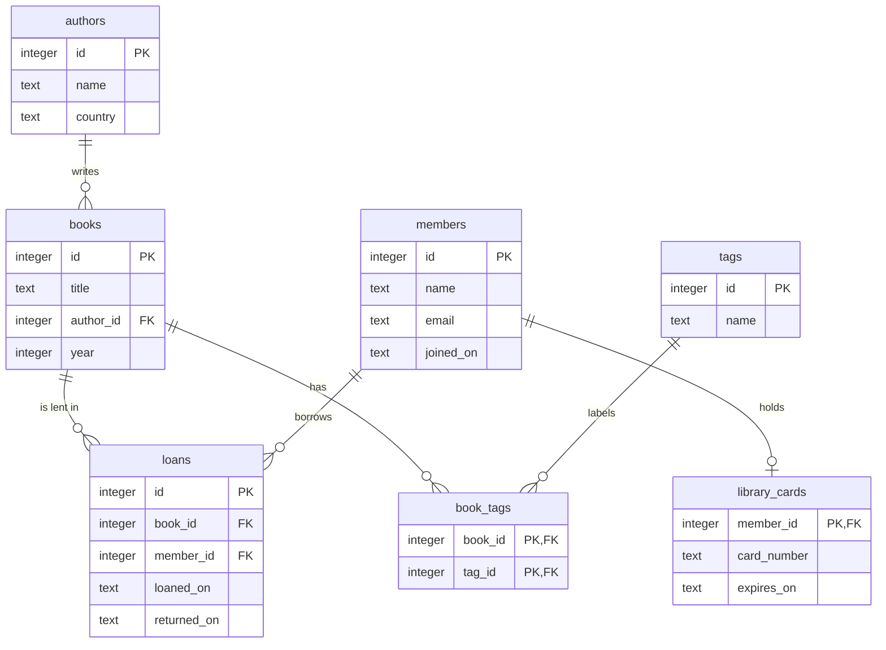

# SQL: Joins & Relationships

<span class="badge badge--time">90 min</span>
<span class="badge badge--level">Data & APIs</span>
<span class="badge">Needs: SQL: CRUD Operations</span>

One table took you a long way, but a real library has more than books:
authors, members, library cards, loans, tags. Each lives in its own
table, and the tables point at each other through **keys**. In this
tutorial you learn how tables relate, and how to **join** them back
together to answer questions that span several of them.

## Why this matters

Almost every useful question crosses tables. "Who has a book out right
now?" needs loans, members and books. "Which authors has nobody
borrowed?" needs authors, books and loans. Real databases have dozens of
tables; joins are how you get answers out of them, and how you notice
what is *missing*, like a member who never borrowed anything.

## Before you start

You need `sqlite3`, as installed in
[SQL: CRUD Operations](sql-crud.md). Download the library database
script and load it into a new file, `library.db`:

```bash
cd ~/library
curl -O https://evisp.github.io/augmented_software_engineering/assets/sql/library.sql
sqlite3 library.db < library.sql
sqlite3 library.db
```

Or download [library.sql](../../assets/sql/library.sql){ download="library.sql" }
from the browser. Loading it again resets every table. The outputs on
this page use `.headers on` and `.mode box`, as before.

## Step 1: From one table to several

In `books.db`, every book repeated its author's name, and there was
nowhere to put a member or a loan. The library database splits the data
into seven tables, one for each kind of thing:

```sql
.tables
```

```text
authors        books          loans          tags         
book_tags      library_cards  members      
```

Instead of repeating the author's name, each book stores the author's
`id`. The name is written once, in `authors`:

```sql
SELECT * FROM books LIMIT 4;
```

```text
┌────┬───────────────────────────────────┬───────────┬──────┐
│ id │               title               │ author_id │ year │
├────┼───────────────────────────────────┼───────────┼──────┤
│ 1  │ Kronikë në gur                    │ 1         │ 1971 │
│ 2  │ Prilli i thyer                    │ 1         │ 1978 │
│ 3  │ Gjenerali i ushtrisë së vdekur    │ 1         │ 1963 │
│ 4  │ Shkëlqimi dhe rënia e shokut Zylo │ 2         │ 1973 │
└────┴───────────────────────────────────┴───────────┴──────┘
```

```sql
SELECT * FROM authors LIMIT 4;
```

```text
┌────┬────────────────┬────────────────┐
│ id │      name      │    country     │
├────┼────────────────┼────────────────┤
│ 1  │ Ismail Kadare  │ Albania        │
│ 2  │ Dritëro Agolli │ Albania        │
│ 3  │ George Orwell  │ United Kingdom │
│ 4  │ Jane Austen    │ United Kingdom │
└────┴────────────────┴────────────────┘
```

Book 1 has `author_id` 1, and author 1 is Ismail Kadare. That number is
the link. An **entity-relationship diagram**, or **ER diagram**, draws
all the tables and their links at once:



Read the line ends as "how many": `||` is exactly one, `o|` is zero or
one, and `o{` is zero or more. So the line between `authors` and
`books` says: one author writes zero or more books, and each book has
exactly one author.

## Step 2: Turn on foreign keys

A **foreign key** is a column that holds the primary key of a row in
another table: `books.author_id` points at `authors.id`. The schema
declares it with `REFERENCES authors (id)`, so the database can check
that every link leads somewhere.

There is a catch. For historical reasons, **SQLite does not check
foreign keys unless you ask**, on every connection:

```sql
PRAGMA foreign_keys;
```

```text
┌──────────────┐
│ foreign_keys │
├──────────────┤
│ 0            │
└──────────────┘
```

With checks off, a loan of book 99, which does not exist, goes in
without a word:

```sql
INSERT INTO loans (book_id, member_id, loaned_on) VALUES (99, 1, '2026-10-30');
SELECT changes() AS inserted;
```

```text
┌──────────┐
│ inserted │
├──────────┤
│ 1        │
└──────────┘
```

That broken row points at nothing. Remove it, and turn the checks on:

```sql
DELETE FROM loans WHERE book_id = 99;
```

```sql
PRAGMA foreign_keys = ON;
PRAGMA foreign_keys;
```

```text
┌──────────────┐
│ foreign_keys │
├──────────────┤
│ 1            │
└──────────────┘
```

Add `PRAGMA foreign_keys = ON;` to your `~/.sqliterc`, next to
`.headers on` and `.mode box`, so every session starts with it. Every
query from here on runs with foreign keys on.

## Step 3: Primary and foreign keys at work

With checks on, the database refuses a link to nothing:

```sql
INSERT INTO loans (book_id, member_id, loaned_on) VALUES (99, 1, '2026-10-30');
```

```text
Runtime error: FOREIGN KEY constraint failed (19)
```

It also refuses to delete a row that others still point at. Kadare has
three books, so he cannot simply disappear:

```sql
DELETE FROM authors WHERE id = 1;
```

```text
Runtime error: FOREIGN KEY constraint failed (19)
```

That is the point of foreign keys: the database itself keeps the links
correct, so no program, and no tired person at a terminal, can leave a
loan that points at a deleted book.

To sum up the two kinds of key:

| | Primary key | Foreign key |
|---|---|---|
| What it does | Identifies each row of its own table | Points at a row of another table |
| Unique? | Yes, and never NULL | No: many books can share one `author_id` |
| Example | `authors.id` | `books.author_id` |

!!! tip "Try it"

    Try to give *Dune* (book 8) an author that does not exist, 42.

??? success "Answer"

    ```sql
    UPDATE books SET author_id = 42 WHERE id = 8;
    ```

    ```text
    Runtime error: FOREIGN KEY constraint failed (19)
    ```

## Step 4: Three kinds of relationship

Every link between two tables is one of three kinds:

<figure class="h-figure" markdown="0">
<svg viewBox="0 0 680 320" role="img" aria-labelledby="sj-rel-title sj-rel-desc">
<title id="sj-rel-title">One-to-one, one-to-many and many-to-many</title>
<desc id="sj-rel-desc">One-to-one: each member has at most one library card, because library_cards uses member_id as its primary key. One-to-many: one author has many books, because each book stores one author_id. Many-to-many: members and books are linked through the loans table: one member has many loans, one book has many loans, and each loan holds one member_id and one book_id.</desc>
<g font-size="11" font-weight="700" fill="var(--h-fig-muted)" text-anchor="middle">
<text x="108" y="14">ONE-TO-ONE</text><text x="340" y="14">ONE-TO-MANY</text><text x="572" y="14">MANY-TO-MANY</text>
</g>
<g font-family="var(--md-code-font-family, monospace)" font-size="12" text-anchor="middle">
<rect x="28" y="28" width="160" height="50" rx="8" fill="var(--h-fig-box)" stroke="var(--h-fig-text)" stroke-width="1.5"/>
<text x="108" y="48" font-weight="700" fill="var(--h-fig-text)">members</text><text x="108" y="66" fill="var(--h-fig-muted)">id PK</text>
<rect x="28" y="228" width="160" height="50" rx="8" fill="var(--h-fig-box)" stroke="var(--h-fig-text)" stroke-width="1.5"/>
<text x="108" y="248" font-weight="700" fill="var(--h-fig-text)">library_cards</text><text x="108" y="266" fill="var(--h-cherry)">member_id PK, FK</text>
<rect x="260" y="28" width="160" height="50" rx="8" fill="var(--h-fig-box)" stroke="var(--h-fig-text)" stroke-width="1.5"/>
<text x="340" y="48" font-weight="700" fill="var(--h-fig-text)">authors</text><text x="340" y="66" fill="var(--h-fig-muted)">id PK</text>
<rect x="260" y="228" width="160" height="50" rx="8" fill="var(--h-fig-box)" stroke="var(--h-fig-text)" stroke-width="1.5"/>
<text x="340" y="248" font-weight="700" fill="var(--h-fig-text)">books</text><text x="340" y="266" fill="var(--h-cherry)">author_id FK</text>
<rect x="492" y="28" width="160" height="50" rx="8" fill="var(--h-fig-box)" stroke="var(--h-fig-text)" stroke-width="1.5"/>
<text x="572" y="48" font-weight="700" fill="var(--h-fig-text)">members</text><text x="572" y="66" fill="var(--h-fig-muted)">id PK</text>
<rect x="492" y="118" width="160" height="70" rx="8" fill="var(--h-cherry)"/>
<text x="572" y="138" font-weight="700" fill="#ffffff">loans</text><text x="572" y="156" fill="#ffffff">member_id FK</text><text x="572" y="174" fill="#ffffff">book_id FK</text>
<rect x="492" y="228" width="160" height="50" rx="8" fill="var(--h-fig-box)" stroke="var(--h-fig-text)" stroke-width="1.5"/>
<text x="572" y="248" font-weight="700" fill="var(--h-fig-text)">books</text><text x="572" y="266" fill="var(--h-fig-muted)">id PK</text>
</g>
<g stroke="var(--h-fig-line)" stroke-width="2">
<line x1="108" y1="80" x2="108" y2="226"/><line x1="340" y1="80" x2="340" y2="226"/>
<line x1="572" y1="80" x2="572" y2="116"/><line x1="572" y1="190" x2="572" y2="226"/>
</g>
<g font-size="12" font-weight="700" fill="var(--h-cherry)" font-family="var(--md-code-font-family, monospace)">
<text x="116" y="96">1</text><text x="116" y="220">0..1</text>
<text x="348" y="96">1</text><text x="348" y="220">many</text>
<text x="580" y="94">1</text><text x="580" y="112">many</text>
<text x="580" y="206">many</text><text x="580" y="224">1</text>
</g>
<g font-size="11.5" fill="var(--h-fig-muted)" text-anchor="middle">
<text x="108" y="298">a member has at most</text><text x="108" y="314">one card</text>
<text x="340" y="298">an author has many books,</text><text x="340" y="314">a book has one author</text>
<text x="572" y="298">a junction table links</text><text x="572" y="314">many members to many books</text>
</g>
</svg>
</figure>

- **One-to-one.** A member has at most one library card. `library_cards`
  uses `member_id` as its own primary key, so the same member cannot
  appear twice. Lea has no card yet, which is allowed: "zero or one".
- **One-to-many.** One author has many books; each book has one author.
  The foreign key always goes on the **many** side: `books.author_id`.
- **Many-to-many.** A member borrows many books, and a book is borrowed
  by many members. One column cannot hold "many", so a third table sits
  in the middle, the **junction table**: each row of `loans` links one
  member to one book, and adds facts about that link, the dates.

`book_tags` is a junction table too, between `books` and `tags`, but a
pure one: just two foreign keys. Its primary key is the **pair**
`(book_id, tag_id)`, a **composite key**, so the same tag cannot be put
on the same book twice.

## Step 5: Combine tables with JOIN

`JOIN` puts two tables side by side, and `ON` says which rows belong
together. Each book with its author's name:

```sql
SELECT books.title, authors.name
FROM books
JOIN authors ON books.author_id = authors.id;
```

```text
┌───────────────────────────────────┬──────────────────┐
│               title               │       name       │
├───────────────────────────────────┼──────────────────┤
│ Kronikë në gur                    │ Ismail Kadare    │
│ Prilli i thyer                    │ Ismail Kadare    │
│ Gjenerali i ushtrisë së vdekur    │ Ismail Kadare    │
│ Shkëlqimi dhe rënia e shokut Zylo │ Dritëro Agolli   │
│ Nineteen Eighty-Four              │ George Orwell    │
│ Animal Farm                       │ George Orwell    │
│ Pride and Prejudice               │ Jane Austen      │
│ Dune                              │ Frank Herbert    │
│ The Hobbit                        │ J. R. R. Tolkien │
│ Things Fall Apart                 │ Chinua Achebe    │
└───────────────────────────────────┴──────────────────┘
```

For every book, SQLite finds the author whose `id` equals the book's
`author_id`, and makes one result row from the pair. This is an
**inner join**: only pairs that match appear. `JOIN` on its own means
`INNER JOIN`.

Long table names get tiring, so give each table a short **alias** with
`AS`, and use it everywhere. After a join, you can filter and sort on
columns from either table. The Albanian books, oldest first:

```sql
SELECT b.title, a.name AS author, a.country
FROM books AS b
JOIN authors AS a ON b.author_id = a.id
WHERE a.country = 'Albania'
ORDER BY b.year;
```

```text
┌───────────────────────────────────┬────────────────┬─────────┐
│               title               │     author     │ country │
├───────────────────────────────────┼────────────────┼─────────┤
│ Gjenerali i ushtrisë së vdekur    │ Ismail Kadare  │ Albania │
│ Kronikë në gur                    │ Ismail Kadare  │ Albania │
│ Shkëlqimi dhe rënia e shokut Zylo │ Dritëro Agolli │ Albania │
│ Prilli i thyer                    │ Ismail Kadare  │ Albania │
└───────────────────────────────────┴────────────────┴─────────┘
```

When two tables have a column with the same name, such as `id`, you must
say which one you mean:

```sql
SELECT id, title, name FROM books JOIN authors ON author_id = authors.id;
```

```text
Parse error: ambiguous column name: id
  SELECT id, title, name FROM books JOIN authors ON author_id = authors.id;
         ^--- error here
```

Join as many tables as you need, one `JOIN ... ON` at a time. Who has a
book out right now? That needs loans, members and books:

```sql
SELECT l.loaned_on, m.name AS member, b.title
FROM loans AS l
JOIN members AS m ON l.member_id = m.id
JOIN books AS b ON l.book_id = b.id
WHERE l.returned_on IS NULL
ORDER BY l.loaned_on;
```

```text
┌────────────┬─────────────┬─────────────────────┐
│ loaned_on  │   member    │        title        │
├────────────┼─────────────┼─────────────────────┤
│ 2026-09-25 │ Erion Shehu │ Pride and Prejudice │
│ 2026-10-03 │ Arta Hoxha  │ Prilli i thyer      │
│ 2026-10-10 │ Drita Leka  │ Dune                │
│ 2026-10-22 │ Arta Hoxha  │ The Hobbit          │
└────────────┴─────────────┴─────────────────────┘
```

!!! tip "Try it"

    List every book Arta Hoxha has borrowed, with its author and the date,
    oldest loan first.

??? success "Answer"

    Four tables: the loan links the member to the book, and the book links
    to its author.

    ```sql
    SELECT l.loaned_on, b.title, a.name AS author
    FROM loans AS l
    JOIN books AS b ON l.book_id = b.id
    JOIN authors AS a ON b.author_id = a.id
    JOIN members AS m ON l.member_id = m.id
    WHERE m.name = 'Arta Hoxha'
    ORDER BY l.loaned_on;
    ```

    ```text
    ┌────────────┬──────────────────────┬──────────────────┐
    │ loaned_on  │        title         │      author      │
    ├────────────┼──────────────────────┼──────────────────┤
    │ 2026-09-02 │ Nineteen Eighty-Four │ George Orwell    │
    │ 2026-09-18 │ Kronikë në gur       │ Ismail Kadare    │
    │ 2026-10-03 │ Prilli i thyer       │ Ismail Kadare    │
    │ 2026-10-22 │ The Hobbit           │ J. R. R. Tolkien │
    └────────────┴──────────────────────┴──────────────────┘
    ```

## Step 6: Keep unmatched rows with LEFT JOIN

An inner join drops every row without a partner. Sometimes that is
exactly the row you are looking for.

<figure class="h-figure" markdown="0">
<svg viewBox="0 0 680 236" role="img" aria-labelledby="sj-left-title sj-left-desc">
<title id="sj-left-title">INNER JOIN drops unmatched rows, LEFT JOIN keeps them</title>
<desc id="sj-left-desc">Three authors: Frank Herbert matches Dune, George Orwell matches Nineteen Eighty-Four and Animal Farm, and Ursula K. Le Guin matches no book. The inner join returns three rows and leaves Le Guin out. The left join returns four rows, keeping Le Guin with NULL as the title.</desc>
<g font-size="11" font-weight="700" fill="var(--h-fig-muted)">
<text x="3" y="14">AUTHORS</text><text x="190" y="14">BOOKS</text>
<text x="400" y="14">INNER JOIN · 3 rows</text><text x="400" y="128">LEFT JOIN · 4 rows</text>
</g>
<g font-size="12" font-family="var(--md-code-font-family, monospace)">
<rect x="3" y="26" width="150" height="28" rx="6" fill="var(--h-fig-box)" stroke="var(--h-fig-text)"/><text x="14" y="45" fill="var(--h-fig-text)">Frank Herbert</text>
<rect x="3" y="86" width="150" height="28" rx="6" fill="var(--h-fig-box)" stroke="var(--h-cherry)" stroke-width="2" stroke-dasharray="5 3"/><text x="14" y="105" fill="var(--h-cherry)" font-weight="700">Ursula K. Le Guin</text>
<rect x="3" y="146" width="150" height="28" rx="6" fill="var(--h-fig-box)" stroke="var(--h-fig-text)"/><text x="14" y="165" fill="var(--h-fig-text)">George Orwell</text>
<rect x="190" y="26" width="170" height="28" rx="6" fill="var(--h-fig-box)" stroke="var(--h-fig-text)"/><text x="201" y="45" fill="var(--h-fig-text)">Dune</text>
<rect x="190" y="146" width="170" height="28" rx="6" fill="var(--h-fig-box)" stroke="var(--h-fig-text)"/><text x="201" y="165" fill="var(--h-fig-text)">Nineteen Eighty-Four</text>
<rect x="190" y="186" width="170" height="28" rx="6" fill="var(--h-fig-box)" stroke="var(--h-fig-text)"/><text x="201" y="205" fill="var(--h-fig-text)">Animal Farm</text>
</g>
<g stroke="var(--h-fig-line)" stroke-width="2"><line x1="155" y1="40" x2="188" y2="40"/><line x1="155" y1="160" x2="188" y2="160"/><line x1="155" y1="160" x2="188" y2="200"/></g>
<text x="162" y="105" font-size="11" font-weight="700" fill="var(--h-cherry)">no match</text>
<g font-size="11.5" font-family="var(--md-code-font-family, monospace)">
<rect x="400" y="22" width="277" height="78" rx="6" fill="var(--h-fig-box)" stroke="var(--h-fig-line)"/>
<g fill="var(--h-fig-text)"><text x="410" y="42">Frank Herbert</text><text x="560" y="42">Dune</text><text x="410" y="66">George Orwell</text><text x="560" y="66">Nineteen Eig…</text><text x="410" y="90">George Orwell</text><text x="560" y="90">Animal Farm</text></g>
<rect x="400" y="136" width="277" height="100" rx="6" fill="var(--h-fig-box)" stroke="var(--h-fig-line)"/>
<g fill="var(--h-fig-text)"><text x="410" y="156">Frank Herbert</text><text x="560" y="156">Dune</text></g>
<rect x="402" y="164" width="273" height="22" fill="var(--h-cherry-wash, rgba(227,28,63,0.09))"/>
<text x="410" y="180" fill="var(--h-cherry)" font-weight="700">Ursula K. Le Guin</text><text x="560" y="180" fill="var(--h-cherry)" font-style="italic">NULL</text>
<g fill="var(--h-fig-text)"><text x="410" y="204">George Orwell</text><text x="560" y="204">Nineteen Eig…</text><text x="410" y="228">George Orwell</text><text x="560" y="228">Animal Farm</text></g>
</g>
</svg>
</figure>

With an inner join, Le Guin, who has no books in the library, vanishes:

```sql
SELECT a.name, b.title
FROM authors AS a
JOIN books AS b ON b.author_id = a.id
WHERE a.country = 'United States';
```

```text
┌───────────────┬───────┐
│     name      │ title │
├───────────────┼───────┤
│ Frank Herbert │ Dune  │
└───────────────┴───────┘
```

`LEFT JOIN` keeps **every row of the left table**, the one before the
word `JOIN`. When there is no partner, the right side's columns are
NULL:

```sql
SELECT a.name, b.title
FROM authors AS a
LEFT JOIN books AS b ON b.author_id = a.id
WHERE a.country = 'United States';
```

```text
┌───────────────────┬───────┐
│       name        │ title │
├───────────────────┼───────┤
│ Frank Herbert     │ Dune  │
│ Ursula K. Le Guin │       │
└───────────────────┴───────┘
```

The same works for the one-to-one link. Every member, with a card
number if they have one:

```sql
SELECT m.name, c.card_number
FROM members AS m
LEFT JOIN library_cards AS c ON c.member_id = m.id;
```

```text
┌─────────────────┬─────────────┐
│      name       │ card_number │
├─────────────────┼─────────────┤
│ Arta Hoxha      │ LIB-0001    │
│ Besnik Krasniqi │ LIB-0002    │
│ Drita Leka      │ LIB-0003    │
│ Erion Shehu     │ LIB-0004    │
│ Lea Marku       │             │
└─────────────────┴─────────────┘
```

Add `WHERE ... IS NULL` on the right table, and you keep **only** the
rows without a partner. This is the standard way to ask "who is
missing?":

```sql
SELECT m.name
FROM members AS m
LEFT JOIN library_cards AS c ON c.member_id = m.id
WHERE c.member_id IS NULL;
```

```text
┌───────────┐
│   name    │
├───────────┤
│ Lea Marku │
└───────────┘
```

Test a column that can never be NULL in a real row, such as the primary
key or the foreign key. Then NULL can only mean "no partner".

!!! tip "Try it"

    Which books have never been borrowed?

??? success "Answer"

    ```sql
    SELECT b.title
    FROM books AS b
    LEFT JOIN loans AS l ON l.book_id = b.id
    WHERE l.id IS NULL;
    ```

    ```text
    ┌───────────────────────────────────┐
    │               title               │
    ├───────────────────────────────────┤
    │ Shkëlqimi dhe rënia e shokut Zylo │
    │ Things Fall Apart                 │
    └───────────────────────────────────┘
    ```

## Step 7: RIGHT and FULL joins

`RIGHT JOIN` is the mirror image: it keeps every row of the **right**
table. This query gives exactly the result of the `LEFT JOIN` of
authors and books in Step 6, with the tables written the other way
round. Most people write the `LEFT` version, with the table they care
about first:

```sql
SELECT a.name, b.title
FROM books AS b
RIGHT JOIN authors AS a ON b.author_id = a.id
WHERE a.country = 'United States';
```

```text
┌───────────────────┬───────┐
│       name        │ title │
├───────────────────┼───────┤
│ Frank Herbert     │ Dune  │
│ Ursula K. Le Guin │       │
└───────────────────┴───────┘
```

`FULL JOIN` keeps unmatched rows from **both** sides. Here it finds the
loose ends of the tags in one query: a book with no tags, and a tag on
no book:

```sql
SELECT b.title, t.name AS tag
FROM books AS b
LEFT JOIN book_tags AS bt ON bt.book_id = b.id
FULL JOIN tags AS t ON t.id = bt.tag_id
WHERE b.id IS NULL OR t.id IS NULL;
```

```text
┌───────────────────┬────────┐
│       title       │  tag   │
├───────────────────┼────────┤
│ Things Fall Apart │        │
│                   │ poetry │
└───────────────────┴────────┘
```

!!! note "SQLite version"

    `RIGHT JOIN` and `FULL JOIN` need SQLite 3.39 or later. Ubuntu 24.04
    ships 3.45; check yours with `sqlite3 --version`. On an older version,
    rewrite a `RIGHT JOIN` as a `LEFT JOIN` with the tables swapped.

## Step 8: Many-to-many through a junction table

To get from a book to its tags, go through the junction table: books to
`book_tags`, then `book_tags` to tags. Three books and their tags:

```sql
SELECT b.title, t.name AS tag
FROM books AS b
JOIN book_tags AS bt ON bt.book_id = b.id
JOIN tags AS t ON t.id = bt.tag_id
WHERE b.id IN (3, 5, 8)
ORDER BY b.id, t.name;
```

```text
┌────────────────────────────────┬──────────┐
│             title              │   tag    │
├────────────────────────────────┼──────────┤
│ Gjenerali i ushtrisë së vdekur │ albanian │
│ Gjenerali i ushtrisë së vdekur │ classic  │
│ Nineteen Eighty-Four           │ classic  │
│ Nineteen Eighty-Four           │ dystopia │
│ Dune                           │ classic  │
│ Dune                           │ sci-fi   │
└────────────────────────────────┴──────────┘
```

A book with two tags appears twice: one row per **pair**. To get one row
per book, group the rows and glue the tags together with
`GROUP_CONCAT`. `LEFT JOIN` keeps the untagged book:

```sql
SELECT b.title, GROUP_CONCAT(t.name, ', ') AS tags
FROM books AS b
LEFT JOIN book_tags AS bt ON bt.book_id = b.id
LEFT JOIN tags AS t ON t.id = bt.tag_id
GROUP BY b.id
ORDER BY b.id;
```

```text
┌───────────────────────────────────┬───────────────────┐
│               title               │       tags        │
├───────────────────────────────────┼───────────────────┤
│ Kronikë në gur                    │ albanian          │
│ Prilli i thyer                    │ albanian          │
│ Gjenerali i ushtrisë së vdekur    │ classic, albanian │
│ Shkëlqimi dhe rënia e shokut Zylo │ albanian          │
│ Nineteen Eighty-Four              │ classic, dystopia │
│ Animal Farm                       │ classic, dystopia │
│ Pride and Prejudice               │ classic           │
│ Dune                              │ classic, sci-fi   │
│ The Hobbit                        │ classic, fantasy  │
│ Things Fall Apart                 │                   │
└───────────────────────────────────┴───────────────────┘
```

`GROUP_CONCAT` does not promise any order for the values it glues
together.

!!! tip "Try it"

    List the titles of every book tagged `classic`, alphabetically.

??? success "Answer"

    ```sql
    SELECT b.title
    FROM books AS b
    JOIN book_tags AS bt ON bt.book_id = b.id
    JOIN tags AS t ON t.id = bt.tag_id
    WHERE t.name = 'classic'
    ORDER BY b.title;
    ```

    ```text
    ┌────────────────────────────────┐
    │             title              │
    ├────────────────────────────────┤
    │ Animal Farm                    │
    │ Dune                           │
    │ Gjenerali i ushtrisë së vdekur │
    │ Nineteen Eighty-Four           │
    │ Pride and Prejudice            │
    │ The Hobbit                     │
    └────────────────────────────────┘
    ```

## Step 9: Count across tables

Joins and `GROUP BY` work together. Loans per member, including members
with none:

```sql
SELECT m.name, COUNT(l.id) AS loans
FROM members AS m
LEFT JOIN loans AS l ON l.member_id = m.id
GROUP BY m.id
ORDER BY loans DESC, m.name;
```

```text
┌─────────────────┬───────┐
│      name       │ loans │
├─────────────────┼───────┤
│ Arta Hoxha      │ 4     │
│ Besnik Krasniqi │ 3     │
│ Drita Leka      │ 3     │
│ Erion Shehu     │ 2     │
│ Lea Marku       │ 0     │
└─────────────────┴───────┘
```

Look closely at `COUNT(l.id)`. With `COUNT(*)`, Lea gets **1**:

```sql
SELECT m.name, COUNT(*) AS loans
FROM members AS m
LEFT JOIN loans AS l ON l.member_id = m.id
GROUP BY m.id
ORDER BY loans DESC, m.name;
```

```text
┌─────────────────┬───────┐
│      name       │ loans │
├─────────────────┼───────┤
│ Arta Hoxha      │ 4     │
│ Besnik Krasniqi │ 3     │
│ Drita Leka      │ 3     │
│ Erion Shehu     │ 2     │
│ Lea Marku       │ 1     │
└─────────────────┴───────┘
```

The `LEFT JOIN` produced one row for Lea, with NULLs on the loan side.
`COUNT(*)` counts that row; `COUNT(l.id)` skips the NULL. **After a
`LEFT JOIN`, count a column of the right table.**

Books borrowed more than once:

```sql
SELECT b.title, COUNT(*) AS times
FROM loans AS l
JOIN books AS b ON l.book_id = b.id
GROUP BY b.id
HAVING COUNT(*) > 1
ORDER BY times DESC, b.title;
```

```text
┌──────────────────────┬───────┐
│        title         │ times │
├──────────────────────┼───────┤
│ Dune                 │ 2     │
│ Kronikë në gur       │ 2     │
│ Nineteen Eighty-Four │ 2     │
│ The Hobbit           │ 2     │
└──────────────────────┴───────┘
```

And how many books carry each tag, including the unused one:

```sql
SELECT t.name AS tag, COUNT(bt.book_id) AS books
FROM tags AS t
LEFT JOIN book_tags AS bt ON bt.tag_id = t.id
GROUP BY t.id
ORDER BY books DESC, t.name;
```

```text
┌──────────┬───────┐
│   tag    │ books │
├──────────┼───────┤
│ classic  │ 6     │
│ albanian │ 4     │
│ dystopia │ 2     │
│ fantasy  │ 1     │
│ sci-fi   │ 1     │
│ poetry   │ 0     │
└──────────┴───────┘
```

!!! tip "Try it"

    Count the loans by the author's country.

??? success "Answer"

    ```sql
    SELECT a.country, COUNT(l.id) AS loans
    FROM loans AS l
    JOIN books AS b ON l.book_id = b.id
    JOIN authors AS a ON b.author_id = a.id
    GROUP BY a.country
    ORDER BY loans DESC;
    ```

    ```text
    ┌────────────────┬───────┐
    │    country     │ loans │
    ├────────────────┼───────┤
    │ United Kingdom │ 6     │
    │ Albania        │ 4     │
    │ United States  │ 2     │
    └────────────────┴───────┘
    ```

## Step 10: Subqueries

A **subquery** is a query inside another query, in brackets. The inner
query runs first, and the outer one uses its answer.

**`IN` with a list from a subquery.** The books by Albanian authors,
without a join:

```sql
SELECT title FROM books
WHERE author_id IN (SELECT id FROM authors WHERE country = 'Albania');
```

```text
┌───────────────────────────────────┐
│               title               │
├───────────────────────────────────┤
│ Kronikë në gur                    │
│ Prilli i thyer                    │
│ Gjenerali i ushtrisë së vdekur    │
│ Shkëlqimi dhe rënia e shokut Zylo │
└───────────────────────────────────┘
```

**`NOT IN`.** The books that never appear in `loans`:

```sql
SELECT title FROM books
WHERE id NOT IN (SELECT book_id FROM loans);
```

```text
┌───────────────────────────────────┐
│               title               │
├───────────────────────────────────┤
│ Shkëlqimi dhe rënia e shokut Zylo │
│ Things Fall Apart                 │
└───────────────────────────────────┘
```

**`NOT EXISTS`.** `EXISTS` asks "does the inner query return at least
one row?". The inner query can use the outer row, here `m.id`, so it
runs once per member. The members who never borrowed anything:

```sql
SELECT name FROM members AS m
WHERE NOT EXISTS (
    SELECT 1 FROM loans AS l WHERE l.member_id = m.id
);
```

```text
┌───────────┐
│   name    │
├───────────┤
│ Lea Marku │
└───────────┘
```

**A single value.** A subquery that returns one value can stand where a
number would. The books older than the average:

```sql
SELECT title, year FROM books
WHERE year < (SELECT AVG(year) FROM books)
ORDER BY year;
```

```text
┌─────────────────────┬──────┐
│        title        │ year │
├─────────────────────┼──────┤
│ Pride and Prejudice │ 1813 │
│ The Hobbit          │ 1937 │
│ Animal Farm         │ 1945 │
└─────────────────────┴──────┘
```

```sql
SELECT AVG(year) AS average_year FROM books;
```

```text
┌──────────────┐
│ average_year │
├──────────────┤
│ 1945.2       │
└──────────────┘
```

!!! warning "`NOT IN` and NULL"

    If the list contains a NULL, `NOT IN` matches nothing at all:

    ```sql
    SELECT COUNT(*) AS books FROM books WHERE id NOT IN (1, 2, NULL);
    ```

    ```text
    ┌───────┐
    │ books │
    ├───────┤
    │ 0     │
    └───────┘
    ```

    "Is 5 not in (1, 2, unknown)?" The answer is "unknown", so no row
    passes. If the subquery's column can be NULL, use `NOT EXISTS`, which
    does not have this problem.

Joins and subqueries often answer the same question. Use whichever
reads more clearly to you; `LEFT JOIN ... IS NULL` and `NOT EXISTS` are
both standard for "what is missing".

!!! tip "Try it"

    Who has borrowed *Dune*? Use subqueries only, no `JOIN`.

??? success "Answer"

    The innermost query finds Dune's `id`, the middle one the members who
    borrowed it:

    ```sql
    SELECT name FROM members
    WHERE id IN (
        SELECT member_id FROM loans
        WHERE book_id = (SELECT id FROM books WHERE title = 'Dune')
    );
    ```

    ```text
    ┌─────────────────┐
    │      name       │
    ├─────────────────┤
    │ Besnik Krasniqi │
    │ Drita Leka      │
    └─────────────────┘
    ```

## Step 11: CROSS JOIN

`CROSS JOIN` pairs **every** row of one table with **every** row of the
other, with no `ON`. Five members and six tags make thirty pairs:

```sql
SELECT COUNT(*) AS pairs FROM members CROSS JOIN tags;
```

```text
┌───────┐
│ pairs │
├───────┤
│ 30    │
└───────┘
```

All six for Arta:

```sql
SELECT m.name, t.name AS tag
FROM members AS m
CROSS JOIN tags AS t
WHERE m.id = 1;
```

```text
┌────────────┬──────────┐
│    name    │   tag    │
├────────────┼──────────┤
│ Arta Hoxha │ classic  │
│ Arta Hoxha │ albanian │
│ Arta Hoxha │ dystopia │
│ Arta Hoxha │ sci-fi   │
│ Arta Hoxha │ fantasy  │
│ Arta Hoxha │ poetry   │
└────────────┴──────────┘
```

On its own, that is rarely useful. It shines when you need every
combination, and then check which ones are missing. A reading
challenge: which members have not yet read a fantasy or a sci-fi book?

```sql
SELECT m.name, t.name AS tag
FROM members AS m
CROSS JOIN tags AS t
WHERE t.name IN ('fantasy', 'sci-fi')
  AND NOT EXISTS (
      SELECT 1
      FROM loans AS l
      JOIN book_tags AS bt ON bt.book_id = l.book_id
      WHERE l.member_id = m.id AND bt.tag_id = t.id
  )
ORDER BY t.name, m.name;
```

```text
┌─────────────────┬─────────┐
│      name       │   tag   │
├─────────────────┼─────────┤
│ Besnik Krasniqi │ fantasy │
│ Erion Shehu     │ fantasy │
│ Lea Marku       │ fantasy │
│ Arta Hoxha      │ sci-fi  │
│ Erion Shehu     │ sci-fi  │
│ Lea Marku       │ sci-fi  │
└─────────────────┴─────────┘
```

!!! danger "A join without a condition is a cross join"

    Forget the `ON`, or list tables with commas and no `WHERE`, and you
    get every combination, silently:

    ```sql
    SELECT COUNT(*) AS rows FROM books, authors;
    ```

    ```text
    ┌──────┐
    │ rows │
    ├──────┤
    │ 80   │
    └──────┘
    ```

    Ten books times eight authors: 80 rows, 70 of them nonsense. If a join
    returns far more rows than you expected, look for a missing condition.

!!! ai "AI in the loop"

    Ask an assistant for a join and check two things before you trust the
    result. **The kind of join**: does the question need unmatched rows,
    such as members with no loans? Then an inner join is wrong. **The row
    count**: predict roughly how many rows the answer should have. A join
    on the wrong column runs without error and returns plausible-looking
    nonsense; the count is usually what gives it away.

## When something goes wrong

??? note "`Parse error: ambiguous column name: id`"

    Two joined tables have a column with that name. Prefix it with the
    table or its alias: `b.id`, `a.id`.

??? note "`Runtime error: FOREIGN KEY constraint failed`"

    The row points at something that does not exist, or you are deleting a
    row that others still point at. Check the ids, or delete or update the
    rows that point at it first.

??? note "A bad foreign key went in without an error"

    Foreign keys are off. Run `PRAGMA foreign_keys = ON;`, and add it to
    `~/.sqliterc`.

??? note "The join returns far too many rows"

    A missing or wrong `ON` condition, or a join through a one-to-many
    link you did not expect, such as a book with two tags appearing twice.
    Check the `ON` of every join, and count rows as you add each table.

??? note "Rows disappear after I join"

    An inner join drops rows with no partner. If you need them, use
    `LEFT JOIN`. A condition on the right table in `WHERE` can also drop
    them; put it in the `ON` instead.

??? note "`Parse error: RIGHT and FULL OUTER JOINs are not currently supported`"

    Your SQLite is older than 3.39. Swap the tables and use `LEFT JOIN`.

## Practice set

Eight exercises on `library.db`, from easy to harder. Reload
`library.sql` first for exactly these results.

**1. One author's books.** List George Orwell's books, oldest first,
using a join.

??? success "Answer"

    ```sql
    SELECT b.title, b.year
    FROM books AS b
    JOIN authors AS a ON b.author_id = a.id
    WHERE a.name = 'George Orwell'
    ORDER BY b.year;
    ```

    ```text
    ┌──────────────────────┬──────┐
    │        title         │ year │
    ├──────────────────────┼──────┤
    │ Animal Farm          │ 1945 │
    │ Nineteen Eighty-Four │ 1949 │
    └──────────────────────┴──────┘
    ```

**2. One-to-one.** Show each member with their card number and expiry
date, the card that expires soonest first.

??? success "Answer"

    ```sql
    SELECT m.name, c.card_number, c.expires_on
    FROM members AS m
    JOIN library_cards AS c ON c.member_id = m.id
    ORDER BY c.expires_on;
    ```

    ```text
    ┌─────────────────┬─────────────┬────────────┐
    │      name       │ card_number │ expires_on │
    ├─────────────────┼─────────────┼────────────┤
    │ Arta Hoxha      │ LIB-0001    │ 2027-01-15 │
    │ Besnik Krasniqi │ LIB-0002    │ 2027-02-03 │
    │ Drita Leka      │ LIB-0003    │ 2027-03-10 │
    │ Erion Shehu     │ LIB-0004    │ 2027-05-22 │
    └─────────────────┴─────────────┴────────────┘
    ```

**3. Missing partners.** Which authors have no books in the library?
Use `NOT EXISTS`.

??? success "Answer"

    ```sql
    SELECT a.name
    FROM authors AS a
    WHERE NOT EXISTS (
        SELECT 1 FROM books AS b WHERE b.author_id = a.id
    );
    ```

    ```text
    ┌───────────────────┐
    │       name        │
    ├───────────────────┤
    │ Ursula K. Le Guin │
    └───────────────────┘
    ```

**4. Overdue.** Which loans started before October and are still not
returned? Show the member, the title and the date.

??? success "Answer"

    ```sql
    SELECT m.name, b.title, l.loaned_on
    FROM loans AS l
    JOIN members AS m ON l.member_id = m.id
    JOIN books AS b ON l.book_id = b.id
    WHERE l.returned_on IS NULL AND l.loaned_on < '2026-10-01';
    ```

    ```text
    ┌─────────────┬─────────────────────┬────────────┐
    │    name     │        title        │ loaned_on  │
    ├─────────────┼─────────────────────┼────────────┤
    │ Erion Shehu │ Pride and Prejudice │ 2026-09-25 │
    └─────────────┴─────────────────────┴────────────┘
    ```

**5. Popular authors.** Count the loans of each author's books,
including authors with none, most borrowed first.

??? success "Answer"

    ```sql
    SELECT a.name, COUNT(l.id) AS loans
    FROM authors AS a
    LEFT JOIN books AS b ON b.author_id = a.id
    LEFT JOIN loans AS l ON l.book_id = b.id
    GROUP BY a.id
    ORDER BY loans DESC, a.name;
    ```

    ```text
    ┌───────────────────┬───────┐
    │       name        │ loans │
    ├───────────────────┼───────┤
    │ Ismail Kadare     │ 4     │
    │ George Orwell     │ 3     │
    │ Frank Herbert     │ 2     │
    │ J. R. R. Tolkien  │ 2     │
    │ Jane Austen       │ 1     │
    │ Chinua Achebe     │ 0     │
    │ Dritëro Agolli    │ 0     │
    │ Ursula K. Le Guin │ 0     │
    └───────────────────┴───────┘
    ```

    Two `LEFT JOIN`s in a row keep the authors without books *and* the
    books without loans, and `COUNT(l.id)` counts zero for both.

**6. Unused tags.** Which tags are on no book? Use `NOT IN`.

??? success "Answer"

    ```sql
    SELECT t.name
    FROM tags AS t
    WHERE t.id NOT IN (SELECT tag_id FROM book_tags);
    ```

    ```text
    ┌────────┐
    │  name  │
    ├────────┤
    │ poetry │
    └────────┘
    ```

    `NOT IN` is safe here, because `book_tags.tag_id` can never be NULL.

**7. Through a junction.** Which members have borrowed at least one
book tagged `albanian`? Each name once.

??? success "Answer"

    `DISTINCT` removes the repeats from members who borrowed several:

    ```sql
    SELECT DISTINCT m.name
    FROM members AS m
    JOIN loans AS l ON l.member_id = m.id
    JOIN book_tags AS bt ON bt.book_id = l.book_id
    JOIN tags AS t ON t.id = bt.tag_id
    WHERE t.name = 'albanian'
    ORDER BY m.name;
    ```

    ```text
    ┌─────────────┐
    │    name     │
    ├─────────────┤
    │ Arta Hoxha  │
    │ Drita Leka  │
    │ Erion Shehu │
    └─────────────┘
    ```

**8. In or out.** List every book with the status `out` if it has a loan
that is not returned yet, and `in` otherwise.

??? success "Answer"

    `CASE WHEN ... THEN ... ELSE ... END` picks a value, and `EXISTS`
    asks whether an open loan exists:

    ```sql
    SELECT b.title,
           CASE WHEN EXISTS (
               SELECT 1 FROM loans AS l
               WHERE l.book_id = b.id AND l.returned_on IS NULL
           ) THEN 'out' ELSE 'in' END AS status
    FROM books AS b
    ORDER BY b.id;
    ```

    ```text
    ┌───────────────────────────────────┬────────┐
    │               title               │ status │
    ├───────────────────────────────────┼────────┤
    │ Kronikë në gur                    │ in     │
    │ Prilli i thyer                    │ out    │
    │ Gjenerali i ushtrisë së vdekur    │ in     │
    │ Shkëlqimi dhe rënia e shokut Zylo │ in     │
    │ Nineteen Eighty-Four              │ in     │
    │ Animal Farm                       │ in     │
    │ Pride and Prejudice               │ out    │
    │ Dune                              │ out    │
    │ The Hobbit                        │ out    │
    │ Things Fall Apart                 │ in     │
    └───────────────────────────────────┴────────┘
    ```

## Explain it to someone

- [ ] Why data is split into several tables instead of one
- [ ] What primary and foreign keys are, and what a foreign key protects
- [ ] Why SQLite needs `PRAGMA foreign_keys = ON`
- [ ] How to read an ER diagram, and the one-to-one, one-to-many and many-to-many relationships
- [ ] What a junction table and a composite key are
- [ ] How an `INNER JOIN` works, and how to join three or more tables with aliases
- [ ] What `LEFT JOIN` keeps that `INNER JOIN` drops, and how to find rows with no partner
- [ ] What `RIGHT JOIN`, `FULL JOIN` and `CROSS JOIN` return
- [ ] Why `COUNT(column)` and not `COUNT(*)` after a `LEFT JOIN`
- [ ] How subqueries work with `IN`, `NOT IN` and `NOT EXISTS`, and the `NOT IN` NULL trap

## Quick reference

| SQL | What it does |
|---|---|
| `PRAGMA foreign_keys = ON;` | Make SQLite check foreign keys (every connection) |
| `col INTEGER REFERENCES t (id)` | Declare a foreign key |
| `PRIMARY KEY (a, b)` | A composite primary key |
| `FROM a JOIN b ON b.a_id = a.id` | Inner join: matching pairs only |
| `FROM a LEFT JOIN b ON ...` | Every row of `a`, NULLs where `b` has no match |
| `... WHERE b.id IS NULL` | Only the rows of `a` with no match |
| `RIGHT JOIN`, `FULL JOIN` | Keep every row of the right table / of both |
| `FROM a CROSS JOIN b` | Every combination |
| `FROM books AS b` | A table alias |
| `WHERE x IN (SELECT ...)` | Filter with a list from a subquery |
| `WHERE NOT EXISTS (SELECT 1 ...)` | Keep rows for which the inner query finds nothing |
| `GROUP_CONCAT(col, ', ')` | Glue a group's values into one text |

## Next

This schema did not appear by accident: each table, key and link answers
a problem that one big table would have. Next you start from exactly
that big table, a messy spreadsheet of loans, and **design** your way to
this schema, step by step.

[Database Design & Normalization](database-design.md){ .h-button }
